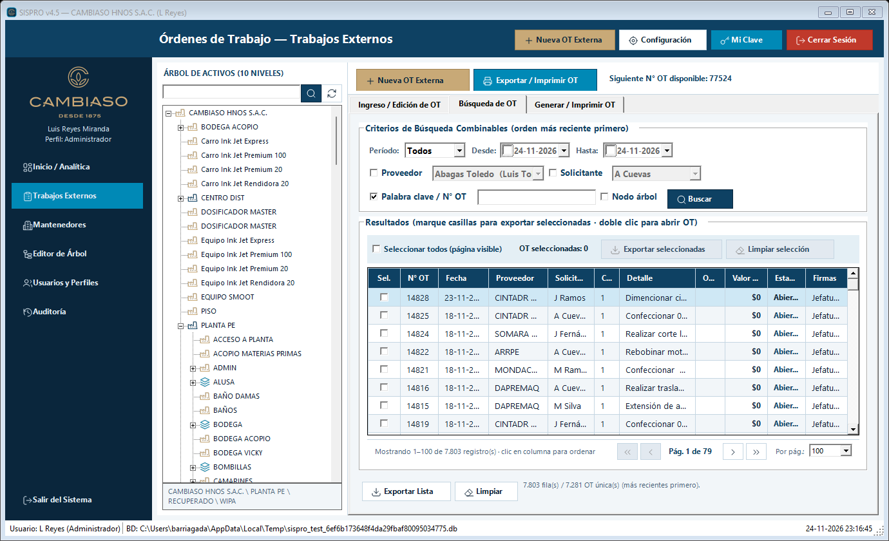
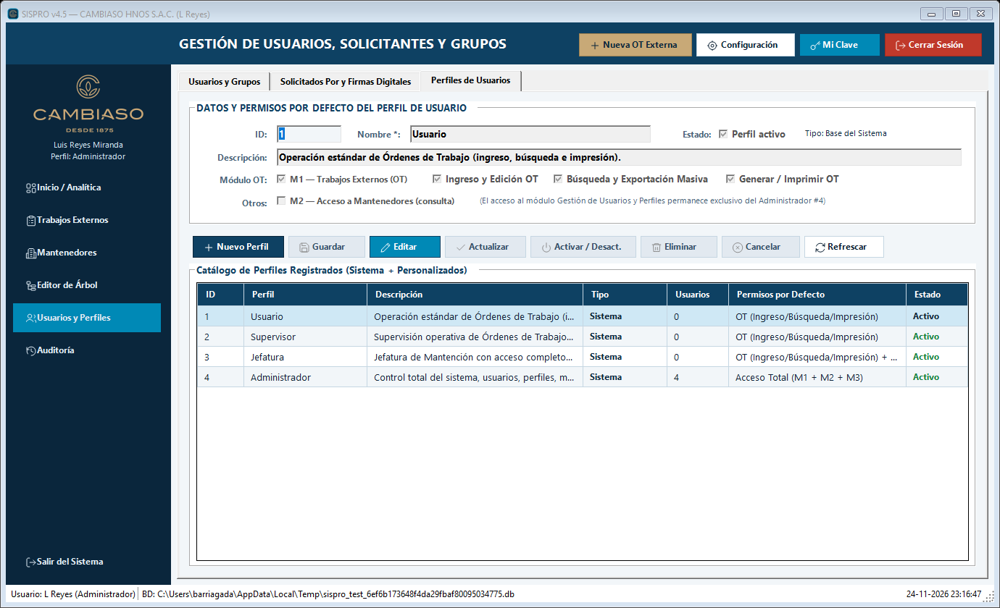
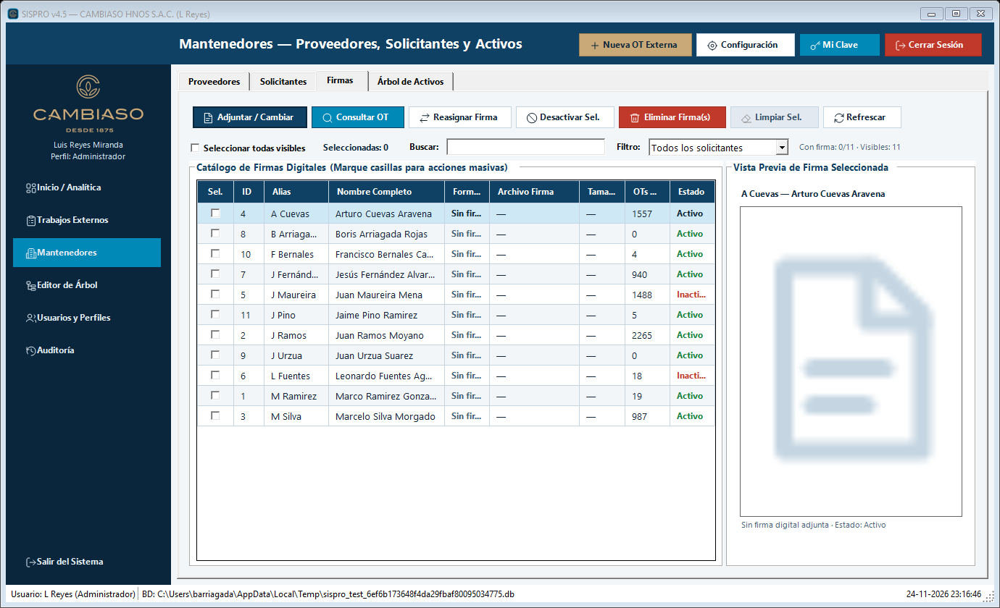

# SISPRO v4.5.0 — Sistema de Gestión de Proveedores, Órdenes de Trabajo y Solicitantes

> **Cambiaso Hnos S.A.C. — Departamento Mantención (Placilla, Valparaíso)**  
> Aplicación de escritorio corporativa en **.NET 10 (`C#` WinForms · `net10.0-windows10.0.19041.0`)** sobre **SQLite 3 (WAL)**, con gestión de Trabajos Externos (OT), **Importación y Comparación desde Microsoft Access (`.mdb`)**, selector de **Firmas al Pie (`Jefatura`, `Técnico`, `Supervisor`) desde Personal y Usuarios**, **Guardar y Exportar / Vista Previa directa**, **visualización de OT con clic derecho**, exportación masiva exclusiva (`.xlsx`, `.csv`, `.pdf`), **Solicitado Por** con **Firma Digital** (`PNG`, `JPG`, `PDF`), **Perfiles de Usuarios dinámicos**, Editor de Árbol de Activos (10 niveles) e instalador **Inno Setup 7**.

---

## Características Principales

- **Panel de Control y Analítica en Vivo:** Banner Hero con botón dorado **Nueva OT Externa**, **5 KPIs clicables**, 3 gráficos vectoriales High-DPI y tabla de OTs recientes con doble clic para editar y **clic derecho → Visualizar OT (Vista Previa)**.
- **Trabajos Externos (`M1`) y Exportación Masiva Exclusiva:** Ingreso/Edición de OT con árbol de 10 niveles, **Observación**, **Valor Neto (CLP)** destacado, **Guardar y Exportar**, **Vista Previa** directa y casillas + listas desplegables de firmantes (`Jefatura`, `Técnico`, `Supervisor`) pobladas desde `Solicitantes`, `Usuarios` y `Mant_Personal`. En **Búsqueda de OT**, checkboxes persistentes por fila y exportación exclusiva de OTs seleccionadas en `.xlsx`, `.csv` y `.pdf`.
- **Importación y Actualización desde Microsoft Access (`.mdb`) (Exclusivo Administrador):** Accesible desde **Mantenedores → Proveedores → `Importar MDB`** y **Configuración → `Importar MDB`**. Analiza el archivo `.mdb` antes de escribir cambios, exhibiendo en 5 KPIs y grilla comparativa **cuántos proveedores son nuevos**, **cuántos tienen campos actualizados (`Actual → Nuevo`)**, **cuántos no cambian** y cuántos **solicitantes u OTs nuevas** existen, permitiendo actualizar `sispro.db` en una transacción atómica con respaldo automático previo (`backups/sispro_pre_mdb_*.db`) y preservando campos exclusivos de SISPRO y firmas digitales.
- **Mantenedores con Integridad Referencial (`M2`):** 4 pestañas (**Proveedores**, **Solicitantes**, **Firmas**, **Árbol de Activos**) con selección múltiple, consulta de dependencias (`MaintainerDependenciesDialog`), reasignación sin pérdida histórica y exportación multiformato.
- **Editor Especial del Árbol de Activos (Exclusivo Administrador):** Administración jerárquica hasta 10 niveles con menús contextuales, prevención de ciclos, normalización de niveles y exportación de ramas en `.xlsx`, `.pdf`, `.docx` y `.csv`.
- **Perfiles, Usuarios y Grupos (Exclusivo Administrador):** Pestaña **Perfiles de Usuarios** para crear/editar perfiles personalizados con permisos por defecto; pestaña **Usuarios y Grupos** con Drag & Drop y operaciones por lotes; pestaña **Solicitados Por y Firmas Digitales** (`PNG`, `JPG`, `PDF` rasterizado vía `Windows.Data.Pdf`).
- **Seguridad, Auditoría y Sincronización:** `PBKDF2-HMAC-SHA256` (100.000 iteraciones), bloqueo ante fuerza bruta, RBAC estricto en UI y capa de servicios, consultas 100 % parametrizadas, sincronización en vivo (`SisproSyncHub` + `PRAGMA data_version`) y bitácora filtrable por módulo (incluidos `Perfiles` e `Importación MDB`).

---

## Tecnologías y Arquitectura

| Capa | Proyecto | Tecnología | Responsabilidad |
|---|---|---|---|
| Dominio | `src/Sispro.Core` | `.NET 10` (`net10.0`) | Entidades, DTOs (`MdbImportDtos`, `SignaturePersonOption`, `CoreDtos`), Enums, interfaces (`IMdbTableReader`), PBKDF2, presets RBAC y validadores. |
| Persistencia | `src/Sispro.Data` | `Microsoft.Data.Sqlite 10.0.15` + `SQLitePCLRaw.lib.e_sqlite3 2.1.14` | Esquema WAL idempotente, migraciones automáticas, respaldos en caliente (`BackupTo`) y 8 repositorios parametrizados. |
| Negocio y Reportes | `src/Sispro.Services` | `ClosedXML 0.105.1` + `DocumentFormat.OpenXml 3.1.1` + `Windows.Data.Pdf` | Servicios RBAC transaccionales, `MdbImportService` + `Jet32MdbTableReader` (`SysWOW64`), `SisproSyncHub`, `ExportSanitizer`, exportadores `.xlsx`/`.pdf`/`.docx`/`.csv` e impresión. |
| Interfaz | `src/Sispro.UI` | WinForms `net10.0-windows10.0.19041.0` (`PerMonitorV2`) | Identidad Cambiaso (`#0A263C`, `#0E4163`, `#0089B6`, `#C8A977`), fuentes GDI+ cacheadas, 56 íconos Lucide (`IconCatalog`), `MdbImportDialog`, `ContextMenuHelper` y vistas modulares. |
| Pruebas | `tests/Sispro.Tests` | `xUnit` | **74 pruebas automatizadas** (Unit, Integration, Sync/Concurrency, Functional incl. Importación `.mdb` / Perfiles / Firmantes / Masivas, UI STA, Regression y Stress). |

---

## Requisitos e Instalación

- **Sistema Operativo:** Windows 10 (19041+) / Windows 11 de 64 bits (`win-x64`).
- **Instalador oficial autocontenido (no requiere instalar .NET previamente):**
  1. Descargar `SISPRO_Setup_v4.5.0_win-x64.exe` desde [Releases](https://github.com/barriagada666-collab/SISPRO-Proveedores/releases).
  2. Verificar integridad con `checksums_sha256.txt` (`SHA-256` v4.5.0: `13E206BFAFA1569AD1810129502AA80D3454C3595614A9E442DB5DECDD6435DA`).
  3. Ejecutar el asistente (**ruta predeterminada:** `C:\Temp`, modificable). Las actualizaciones y desinstalaciones preservan íntegramente `sispro.db`.

---

## Configuración y Uso Rápido

- **Base de datos activa:** `%LOCALAPPDATA%\Cambiaso\SISPRO\sispro.db` (o ruta compartida de red seleccionable desde **Configuración**).
- **Primer acceso Administrador:** cuenta `barriagada` aprovisionada con `PBKDF2-HMAC-SHA256` y cambio obligatorio de contraseña en el primer ingreso. *Ninguna contraseña se almacena en este repositorio.*
- **Actualizar desde Access (`.mdb`):** como Administrador, abrir **Mantenedores → Proveedores → `Importar MDB`** (o **Configuración → `Importar MDB`**) → **Examinar...** → **Analizar MDB** → revisar el resumen y presionar **Actualizar BD desde MDB**.

---

## Capturas de Pantalla

| Inicio / Splash | Panel de Control |
|---|---|
|  |  |

| Trabajos Externos (Ingreso OT) | Búsqueda y Exportación Masiva |
|---|---|
|  |  |

| Mantenedores (Proveedores + Importar MDB) | Importar y Comparar Access (`.mdb`) |
|---|---|
|  |  |

| Usuarios y Grupos (RBAC) | Perfiles de Usuarios |
|---|---|
|  |  |

| Mantenedores Firmas | Auditoría por Módulo y Fechas |
|---|---|
|  |  |

---

## Compilación y Despliegue

```powershell
# Compilar Debug y Release (0 errores, 0 advertencias)
dotnet build SISPRO.sln -c Debug
dotnet build SISPRO.sln -c Release

# Ejecutar las 74 pruebas automatizadas
dotnet test SISPRO.sln -c Release --no-build

# Compilar publicación autocontenida win-x64 + instalador Inno Setup 7 (v4.5.0) + SHA-256
.\scripts\Build-Release.ps1
```

---

## Documentación, Versionado e Historial

- [Informe de Entrega `v4.5.0`](docs/INFORME_ENTREGA_v4.5.0.md)
- [Informe de Entrega `v4.4.0`](docs/INFORME_ENTREGA_v4.4.0.md)
- [Informe de Entrega `v4.3.0`](docs/INFORME_ENTREGA_v4.3.0.md)
- [Informe de Entrega `v4.2.1`](docs/INFORME_ENTREGA_v4.2.1.md) · [`v4.2.0`](docs/INFORME_ENTREGA_v4.2.0.md) · [`v4.1.0`](docs/INFORME_ENTREGA_v4.1.0.md) · [Base `v4.0.0`](docs/INFORME_FINAL_ENTREGA.md)
- [Historial de Cambios (`CHANGELOG.md`)](CHANGELOG.md)
- [Arquitectura Técnica](docs/ARQUITECTURA_TECNICA.md) · [Manual Funcional](docs/MANUAL_FUNCIONAL.md) · [Reporte de Pruebas](docs/REPORTE_PRUEBAS.md) · [Guía de Compilación](docs/GUIA_COMPILACION.md) · [Guía de Despliegue](docs/GUIA_DESPLIEGUE.md)

---

## Créditos

Desarrollado para **Cambiaso Hnos S.A.C. — Departamento Mantención**, Placilla, Valparaíso, Chile.  
Licencia: [MIT](LICENSE).
