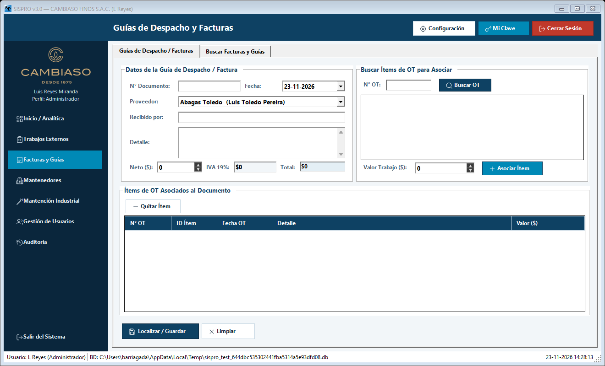
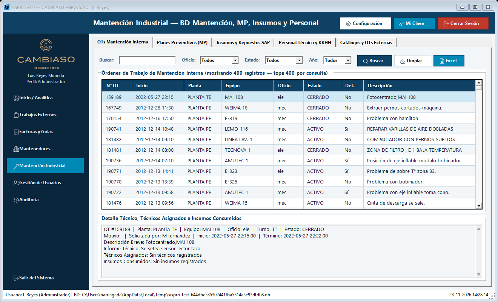

<div align="center">

# SISPRO v3.0 — Sistema Integral de Proveedores y Mantención Industrial

**Cambiaso Hnos S.A.C. · División Mantención Industrial (Placilla, Valparaíso)**

[](https://dotnet.microsoft.com/)
[](https://learn.microsoft.com/dotnet/csharp/)
[-003B57?style=for-the-badge&logo=sqlite)](https://www.sqlite.org/)
[](docs/REPORTE_PRUEBAS.md)
[](docs/GUIA_COMPILACION.md)
[](LICENSE)

*Modernización integral a **.NET 10** de **SISPRO (Proveedores)** unificando la base histórica completa de `OT_PROV.mdb` (2010–2026), `BD MANTENCION.mdb` y `PERSONAL_MANTENCION.mdb` en un motor embebido **SQLite WAL** de alto rendimiento con analítica visual moderna, iconografía vectorial Lucide 24×24 y seguridad RBAC empresarial.*

</div>

---

## Características Principales

- **Panel de Control y Analítica en Vivo**:
  - 5 tarjetas KPI con insignias vectoriales Lucide (**7.284** OTs Proveedores, **214** Proveedores activos, **1.823** Activos reales, **43.989** OTs Mantención, **780** Planes MP / **2.462** Insumos SAP).
  - 3 gráficas vectoriales High-DPI con antialiasing: **Evolución Anual de OTs**, **Distribución por Planta Industrial** (gráfico Donut) y **Top 6 Proveedores Históricos** (ranking horizontal).
  - Grilla instantánea (`< 5 ms`) con las últimas 40 OTs registradas y apertura directa por doble clic.
- **Órdenes de Trabajo Externas (`M1`)**:
  - Árbol jerárquico real de **1.824 activos industriales (10 niveles)** importado de `BD MANTENCION.mdb`, con carga diferida, búsqueda por nombre/SAP/modelo/serie y sincronización automática.
  - Ingreso, modificación, eliminación protegida y aprobaciones **VB Supervisor (`VBS`)** y **VB Jefatura (`VBJ`)** con trazabilidad auditable.
  - Generación de documentos oficiales de OT en **Excel (`.xlsx`)** con logotipo corporativo y firmas digitales (`JR` / `MS`) sin Microsoft Office (**ClosedXML**), además de **Vista Previa e Impresión nativa**.
- **Facturas y Guías de Despacho (`M2`)**:
  - Asociación validada por proveedor, prevención de ítems duplicados, cálculo automático de **Neto, IVA 19% y Total c/IVA**, eliminación con reversa transaccional y exportación Excel.
- **Mantenedores y Ficha Técnica de Activos (`M3`)**:
  - CRUD completo de **Proveedores (214)**, **Solicitantes (11)** y **Árbol de Activos** con edición de ficha técnica industrial (`Código SAP`, `Fabricante`, `Modelo`, `Serie`, `Tipo Equipo`, `Estado Operativo`, `Categoría`, `Observación`).
- **Mantención Industrial (Integración `BD MANTENCION.mdb` + `PERSONAL_MANTENCION.mdb`)**:
  - **OTs de Mantención Interna (`43.989`)**: búsqueda indexada por texto, oficio, estado y año, con detalle de informe técnico, técnicos asignados e insumos consumidos + exportación Excel.
  - **Planes Preventivos MP (`780` planes · `7.704` ciclos · `208.121` tareas)**: exploración jerárquica de planes, ciclos y tareas.
  - **Insumos y Repuestos SAP (`2.462` ítems · `3.886` consumos)**: consulta instantánea por SAP, proveedor o descripción + exportación Excel.
  - **Personal Técnico y RRHH (`134` técnicos · `43` fichas RRHH)** y **Catálogos** (`56` OTs externas históricas, `41` motivos de falla, `33` oficios, `48` tareas checklist).
- **Gestión de Usuarios y Seguridad RBAC (`M4` — Exclusivo Administrador)**:
  - Módulo CRUD completo de dos secciones (`DATOS DEL USUARIO` + `LISTADO DE USUARIOS`) con los 10 botones operativos, ID automático, búsqueda y filtros combinados, indicadores visuales Activo/Inactivo, eliminación lógica y gestión segura de contraseñas.
  - Validación exclusiva de perfil `Administrador` en interfaz y backend (revalidado contra BD), aprovisionamiento seguro e idempotente (`scripts/Initialize-AdminUser.ps1`), cambio obligatorio de contraseña en primer inicio de sesión, cifrado **PBKDF2-HMAC-SHA256** (`100.000` iteraciones + salt aleatorio), cero contraseñas en texto plano en código fuente, bloqueo ante fuerza bruta y **Bitácora de Auditoría (`AuditLog`)**.

---

## Capturas de Pantalla

### Arranque Corporativo, Acceso y Panel Analítico
| Pantalla de Arranque Corporativa | Acceso al Sistema |
| :---: | :---: |
|  |  |

| Panel de Control y Analítica en Vivo | Órdenes de Trabajo y Árbol de Activos Real |
| :---: | :---: |
|  |  |

### Facturación, Mantenedores, Mantención Industrial y Gestión de Usuarios
| Facturas y Guías de Despacho | Mantenedores (Proveedores, Solicitantes y Activos) |
| :---: | :---: |
|  |  |

| Mantención Industrial (`BD MANTENCION.mdb`) | Gestión de Usuarios (CRUD + RBAC Exclusivo Admin) |
| :---: | :---: |
|  |  |

---

## Arquitectura del Proyecto

```text
SISPRO/
├── SISPRO.sln                       # Solución principal .NET 10
├── Directory.Build.props            # Configuración global (v3.0.0, C# latest, Nullable, 0 Warnings)
├── src/
│   ├── Sispro.Core/                 # Entidades, DTOs analíticos/mantención, RBAC, PBKDF2 y Validadores
│   ├── Sispro.Data/                 # SQLite WAL, SchemaInitializer, InitialAdminProvisioner y Repositorios
│   ├── Sispro.Services/             # Lógica de negocio, MaintenanceService, ClosedXML y PrintDocument
│   └── Sispro.UI/                   # WinForms .NET 10, ModernChartPanel, IconCatalog Lucide y Diálogos
├── tests/
│   └── Sispro.Tests/                # 37 pruebas xUnit (Unit, Integration, Functional, UI, Regression, Stress)
├── data/
│   └── sispro.db                    # Base SQLite unificada (343.400+ filas reales, 0 violaciones FK)
├── installer/
│   └── Setup_SISPRO.iss             # Instalador profesional Inno Setup 6 autocontenido win-x64
├── scripts/
│   ├── Build-Release.ps1            # Automatización: Debug + Release + Tests + Publish + Setup + SHA-256
│   ├── Initialize-AdminUser.ps1     # Aprovisionamiento seguro e idempotente de Administrador inicial
│   ├── Migrate-MdbToSqlite.ps1      # Migración streaming desde OT_PROV.mdb + BD MANTENCION.mdb + PERSONAL
│   └── build_sqlite.py              # Constructor, normalizador e integrador SQLite unificado
└── docs/
    ├── AUDITORIA_MIGRACION.md       # Auditoría completa VB6 y matriz de correcciones
    ├── ARQUITECTURA_TECNICA.md      # Diseño en capas, diagrama ER y modelo de seguridad
    ├── MANUAL_FUNCIONAL.md          # Guía de usuario módulo por módulo
    ├── GUIA_COMPILACION.md          # Compilación, pruebas y empaquetado
    ├── GUIA_DESPLIEGUE.md           # Instalación, actualización, red compartida y respaldos
    └── REPORTE_PRUEBAS.md           # Resultados detallados de las 37 pruebas automatizadas
```

---

## Requisitos

### Para Usuarios Finales (Instalador)
- **Windows 10 (1809+) o Windows 11 (x64)**.
- **No requiere instalar .NET, Microsoft Access ni Microsoft Excel** (instalador autocontenido).

### Para Desarrollo / Compilación
- **.NET 10 SDK** (`10.0.100+`).
- **Inno Setup 6** (solo para generar el instalador `.exe`).

---

## Instalación y Uso

### Instalación Rápida (Producción)
1. Descargue `SISPRO_Setup_v3.0.0_win-x64.exe` desde la sección de **Releases** o compílelo con `.\scripts\Build-Release.ps1`.
2. Ejecute el instalador (compatible con instalación de usuario o de sistema; preserva intacta la base `Data\sispro.db` durante actualizaciones).
3. Inicie **SISPRO** desde el Menú Inicio:
   - La base `data/sispro.db` incluye la cuenta Administrador inicial aprovisionada con cambio obligatorio de contraseña en el primer inicio de sesión, además de las cuentas migradas de `OT_PROV.mdb`.
   - Para aprovisionar una cuenta Administrador inicial en una base nueva vacía (sin exponer contraseñas en código fuente):
     ```powershell
     .\scripts\Initialize-AdminUser.ps1 -DatabasePath ".\data\sispro.db" -Username "<usuario>"
     ```
     o defina las variables de entorno `SISPRO_INIT_ADMIN_USER` y `SISPRO_INIT_ADMIN_PASSWORD` / `SISPRO_INIT_ADMIN_HASH`.

### Compilación y Pruebas desde Código Fuente
```powershell
# Restaurar y compilar Debug + Release (0 errores, 0 advertencias)
dotnet restore SISPRO.sln
dotnet build SISPRO.sln -c Debug --no-restore
dotnet build SISPRO.sln -c Release --no-restore

# Ejecutar las 37 pruebas automatizadas
dotnet test SISPRO.sln -c Release --no-build --verbosity normal

# Generar compilación autocontenida win-x64 e instalador Inno Setup 6
.\scripts\Build-Release.ps1
```

---

## Configuración

La configuración se almacena en `%LOCALAPPDATA%\Cambiaso\SISPRO\settings.json` y se edita gráficamente desde **Configuración** (solo Administradores):
- **Base de datos activa**: por defecto `%LOCALAPPDATA%\Cambiaso\SISPRO\sispro.db` (copiada automáticamente desde `Data\sispro.db` en el primer arranque; puede apuntar a una carpeta de red compartida para uso multiusuario).
- **Datos corporativos**: Razón Social, RUT, Departamento y Dirección utilizados en reportes Excel e impresión.
- **Respaldo en caliente**: botón **Respaldar BD** que genera copias consistentes sin detener el sistema.

---

## Versionado e Historial de Cambios

Este proyecto sigue [Semantic Versioning](https://semver.org/). Consulte el historial completo en [CHANGELOG.md](CHANGELOG.md):
- **v3.0.0 (2026-11-23)**: Importación integral de `OT_PROV.mdb` (7.284 OTs), `BD MANTENCION.mdb` (1.824 activos reales, 43.989 OTs internas, 780 planes MP, 208.121 tareas MP, 2.462 insumos SAP, 134 técnicos) y `PERSONAL_MANTENCION.mdb`, nuevo módulo **Mantención Industrial**, gráficas vectoriales modernas en el Dashboard, ficha técnica de activos y 37/37 pruebas.
- **v2.1.0 (2026-11-23)**: Módulo profesional **GESTIÓN DE USUARIOS** (CRUD completo, eliminación lógica, RBAC exclusivo Administrador y aprovisionamiento seguro con cambio obligatorio en primer acceso).
- **v2.0.0 (2026-11-23)**: Migración completa de VB6 + Access a .NET 10 + SQLite WAL con marca corporativa Cambiaso.
- **v1.0.0 (2011-11-03)**: Versión original en Visual Basic 6 (`Proveedores.exe`).

---

## Créditos y Licencia

Desarrollado y modernizado para **Cambiaso Hnos S.A.C. — División Mantención Industrial (Placilla, Valparaíso, Chile)**.
Distribuido bajo licencia **MIT** — consulte [LICENSE](LICENSE).
