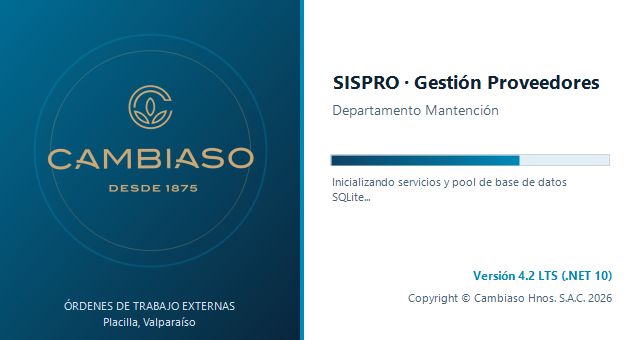
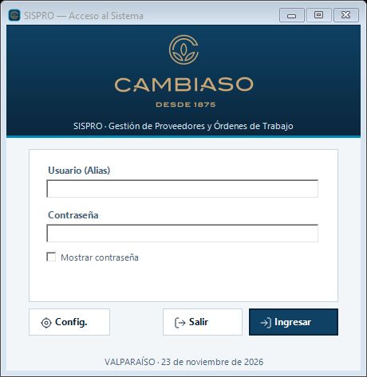
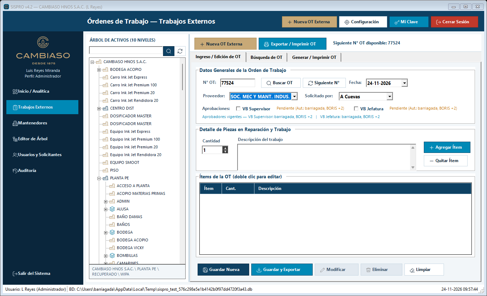
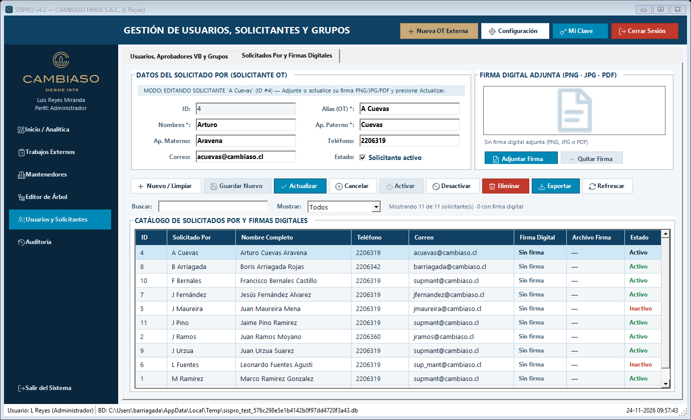
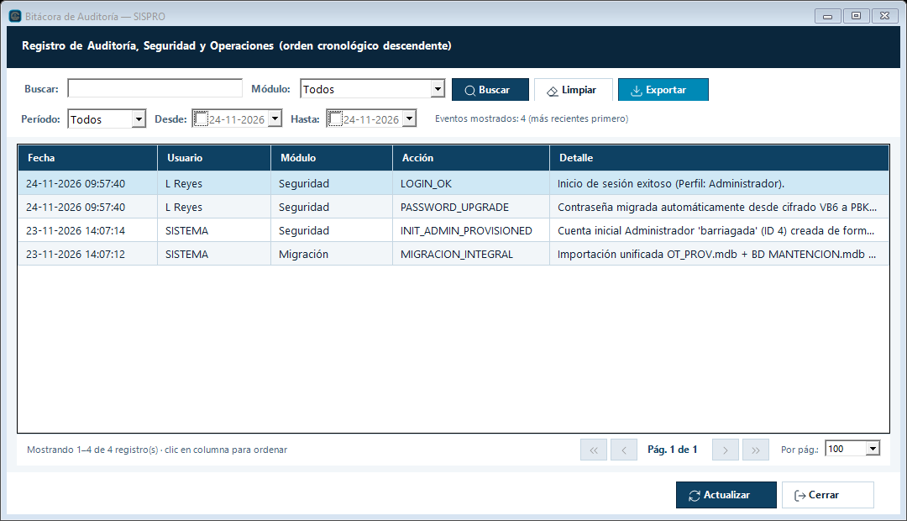
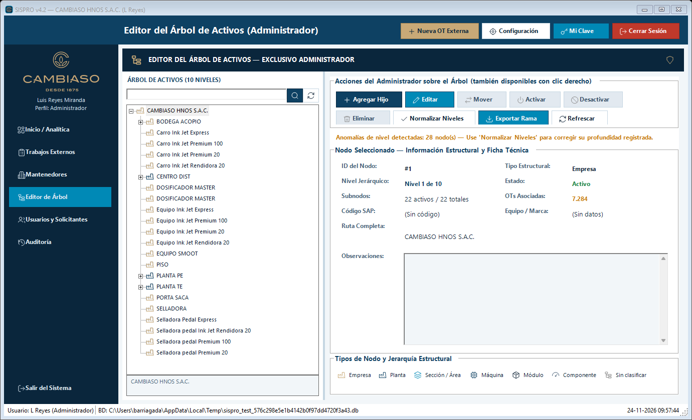

# SISPRO v4.2.0 — Sistema de Gestión de Proveedores, Trabajos Externos y Solicitantes

> **Cambiaso Hnos S.A.C. — Departamento Mantención (Placilla, Valparaíso)**  
> Aplicación de escritorio corporativa desarrollada en **.NET 10 (`C#` WinForms · `net10.0-windows10.0.19041.0`)** sobre **SQLite 3 (WAL)**, con gestión integral de Trabajos Externos (OT), **Solicitado Por** con **Firma Digital** (`PNG`, `JPG`, `PDF`), identificación en vivo de aprobadores **VB Supervisor (`VBS`)** y **VB Jefatura (`VBJ`)**, Árbol de Activos de 10 niveles, Proveedores, Gestión Dinámica de Usuarios y Grupos en 3 áreas, exportaciones corporativas multiformato (**Excel, PDF, Word, CSV**) e instalador **Inno Setup 6**.

---

## Características Principales

- **Panel de Control y Trabajos Externos en Primer Plano:** Banner Hero principal con el botón dorado **Nueva OT Externa**, resumen en vivo de aprobadores vigentes **VB Supervisor** y **VB Jefatura**, **5 KPIs clicables** (**OTs Externas**, **Proveedores**, **Activos Reales**, **Pendientes VB**, **Solicitantes / Firmas**), 3 gráficos vectoriales High-DPI y tabla reciente con columnas `VBS` / `VBJ` mostrando identidad de quien aprobó (`Sí (<alias>)` / `Pendiente`) y menús contextuales de clic derecho.
- **Órdenes de Trabajo Externas (`M1`):** Acceso rápido **Nueva OT Externa**, botón **Exportar / Imprimir OT**, **Guardar y Exportar**, árbol industrial de 10 niveles con preservación de selección ante sincronización, correlativo automático, aprobaciones `VBS`/`VBJ` con usuario y fecha/hora (o autorizados vigentes), búsqueda combinada con Date Pickers (`dd-MM-yyyy`), generación e impresión oficial con firma digital del solicitante (`PNG`/`JPG`/`PDF`) y/o firmas corporativas, y exportación en **Excel, PDF, Word y CSV** (vía `ContextMenuHelper` libre de `ObjectDisposedException`).
- **Gestión de "Solicitado Por" y Firma Digital (`PNG`, `JPG`, `PDF`):** Subpestaña dedicada `Solicitados Por y Firmas Digitales` en **Usuarios y Solicitantes**, pestaña compartida `Solicitantes y Firmas` en **Mantenedores** (`RequesterManagerControl`), y adjunto/vista previa directa al crear o editar un usuario marcado `Solicitante OT`. Archivos `PDF` se rasterizan automáticamente en su página 1 vía `Windows.Data.Pdf.PdfDocument` para vista previa e incrustación en documentos sin dependencias vulnerables.
- **Editor Especial del Árbol de Activos (Exclusivo Administrador):** Acceso dedicado en el menú lateral (**Editor de Árbol**) y menús de clic derecho sobre `AssetTreePanel` para **Crear hijos**, **Editar ficha técnica y tipo estructural** (`Empresa`, `Planta`, `Sección / Área`, `Máquina`, `Módulo`, `Componente`), **Mover subárboles**, **Activar / Desactivar en cascada**, **Eliminar nodos hoja sin dependencias**, **Normalizar niveles** y **Exportar Rama** (`.xlsx`, `.pdf`, `.docx`, `.csv`). Protegido por RBAC estricto en BD (`AssetTreeService`) y auditoría de accesos denegados.
- **Menús Contextuales Universales de Clic Derecho (`ContextMenuHelper`):** Disponibles en Árbol de Activos, Trabajos Externos, Mantenedores (Proveedores/Solicitantes), Gestión de Usuarios y Grupos (grilla y grupos) y Panel de Control.
- **Mantenedores (`M2`):** Administración integral de **Proveedores**, **Solicitantes y Firmas** y consulta técnica del **Árbol de Activos** (edición restringida exclusivamente al perfil Administrador).
- **Gestión Dinámica de Usuarios y Grupos (Exclusivo Administrador):** Franja `APROBADORES OT VIGENTES` (`VBS`/`VBJ`), panel de grupos con Drag & Drop (`MECÁNICOS`, `ELÉCTRICOS`, `ELECTRÓNICOS`, `EXTERNOS`, `OPERADORES` + categorías propias), grilla de 14 columnas (incluyendo `VBS`, `VBJ` y `Solicitante / Firma`), CheckBoxes y operaciones por lotes (`Activar`, `Desactivar`, `Eliminar` lógico, `Mover`, `Cambiar Perfil`, `Exportar`, `Imprimir`, `Refrescar`).
- **Sincronización Inmediata y Concurrencia:** Bus reactivo post-commit (`SisproSyncHub`), detección entre sesiones vía `PRAGMA data_version` (cada 2,5 s) sin resetear selecciones activas, y concurrencia optimista (`row_version`).
- **Seguridad Empresarial:** Autenticación PBKDF2-HMAC-SHA256 (100.000 iteraciones), cambio obligatorio en primer acceso, bloqueo por intentos fallidos, RBAC estricto en capa de servicios y BD, consultas SQL 100% parametrizadas y bitácora de auditoría exportable.

---

## Tecnologías y Arquitectura

| Capa | Proyecto | Tecnología | Responsabilidad |
|---|---|---|---|
| Dominio | `src/Sispro.Core` | `.NET 10` (`net10.0`) | Entidades, DTOs (`ApproverDirectoryEntry`, `WorkOrderSearchRow`), Enums (`SignatureOption`, `UserRoleLevel`), PBKDF2, presets RBAC y validadores. |
| Persistencia | `src/Sispro.Data` | `Microsoft.Data.Sqlite 10.0.15` + `SQLitePCLRaw.lib.e_sqlite3 2.1.14` | Esquema idempotente WAL, migración automática de columnas de firma en `Solicitantes`, aprovisionamiento seguro y 7 repositorios parametrizados. |
| Negocio y Reportes | `src/Sispro.Services` | `ClosedXML 0.105.1` + `DocumentFormat.OpenXml 3.1.1` + `Windows.Data.Pdf` | Servicios transaccionales RBAC (`AssetTreeService`, `SignatureFileService`, `WorkOrderService`, etc.), `SisproSyncHub`, `ExportSanitizer` y exportadores Excel/PDF/Word/CSV e impresión. |
| Interfaz | `src/Sispro.UI` | WinForms `net10.0-windows10.0.19041.0` (`PerMonitorV2`) | Identidad Cambiaso (`#0A263C`, `#0E4163`, `#0089B6`, `#C8A977`), 55 íconos Lucide (`IconCatalog` aislado por hilo STA), `ContextMenuHelper`, `RequesterManagerControl`, `SortableBindingList<T>`, `GridPagerBar` y vistas modulares. |
| Pruebas | `tests/Sispro.Tests` | `xUnit` | **62 pruebas** (Unit, Integration, Functional incl. Solicitantes/Firmas/VB, Tree Admin, ContextMenu & Grid Sort/Pagination STA, UI Audit, Regression, Stress). |

---

## Requisitos e Instalación

- **Sistema Operativo:** Windows 10 (19041+) / Windows 11 (64 bits, `win-x64`).
- **Instalador oficial (autocontenido — no requiere instalar .NET previamente):**
  1. Descargar `SISPRO_Setup_v4.2.0_win-x64.exe` desde la sección [Releases](https://github.com/barriagada666-collab/SISPRO-Proveedores/releases).
  2. Ejecutar el asistente de instalación. **Ruta predeterminada:** `C:\Temp` (modificable por el usuario durante la instalación).
  3. El instalador configura accesos directos, ícono corporativo multi-resolución y copia la base de datos inicial solo si no existe (las actualizaciones y desinstalaciones preservan los datos).

---

## Configuración y Primer Acceso

- Al iniciar, SISPRO resuelve automáticamente la base SQLite en `%LOCALAPPDATA%\Cambiaso\SISPRO\sispro.db` (copiándola desde `Data\sispro.db` en el primer arranque para operar sin privilegios de administrador).
- Desde el botón **Configuración** (exclusivo Administrador) se puede cambiar la ruta de la base de datos, generar respaldos en caliente (`BackupTo`) y ajustar los datos de la empresa.
- **Cuenta Administrador inicial:** `barriagada` (aprovisionada de forma segura con PBKDF2-HMAC-SHA256; exige cambio obligatorio de contraseña en el primer inicio de sesión). *Las credenciales iniciales nunca se almacenan en código fuente ni en este repositorio.*

---

## Gestión de Usuarios, Grupos y Permisos (RBAC)

- **Acceso exclusivo `Administrador`:** Crear, editar, activar, desactivar, eliminar lógicamente, cambiar perfiles, asignar permisos, administrar solicitantes/firmas, administrar grupos, mover usuarios, ejecutar operaciones masivas y revisar auditorías.
- **Perfiles disponibles (`10` permisos granulares):** `Administrador` (acceso total 10/10), `Jefatura` (OT + VBJ + Mantenedores), `Supervisor` (OT + VBS), `Usuario` (consulta/ingreso según asignación).
- **Grupos base:** `MECÁNICOS`, `ELÉCTRICOS`, `ELECTRÓNICOS`, `EXTERNOS`, `OPERADORES` (extensibles y administrables con responsable, estado y protección contra borrado si existen integrantes o historial de movimientos).

---

## Base de Datos SQLite (`data/sispro.db`)

La base operativa `data/sispro.db` mantiene íntegramente los datos migrados de trabajos externos desde `OT_PROV.mdb` (detalle completo en [docs/REPORTE_MIGRACION_OT_PROV.md](docs/REPORTE_MIGRACION_OT_PROV.md)) con migración automática de esquema en el arranque para firmas digitales de solicitantes:

| Entidad Operativa | Registros en `data/sispro.db` | Notas |
|---|---:|---|
| `OrdenesTrabajo` / `DetalleOT` | `7.284` / `7.803` | Histórico completo de trabajos externos (`PRAGMA integrity_check = ok`). |
| `Proveedores` | `214` | Catálogo 100% activo para asociación de OTs. |
| `Activos` | `1.824` (`1.823` activos) | Árbol jerárquico de 10 niveles. |
| `Solicitantes` | `11` (`9` activos) | Solicitantes históricos preservados + soporte `PNG`/`JPG`/`PDF`. |
| `Usuarios` / `Grupos` | `4` / `5` | Cuentas migradas + aprovisionamiento seguro y 5 grupos base. |

---

## Fechas, Búsquedas y Exportaciones

- Todos los campos temporales utilizan **Date Pickers** en formato **`dd-MM-yyyy`** con atajos rápidos (`Todos`, `Hoy`, `Últ. Semana`, `Últ. Mes`, `Este Año`, `Rango`), validación `Desde <= Hasta` y día final inclusivo (`23:59:59`).
- Todos los listados históricos se ordenan en **orden cronológico descendente desde SQLite** (`ORDER BY fecha DESC, id DESC`).
- Todos los módulos principales exportan el resultado filtrado y ordenado en **4 formatos corporativos**:
  - **Excel (`.xlsx`):** Logo, encabezado Petrol/Dorado, AutoFilter, formatos chilenos y firmas digitales (incluyendo firma de solicitante).
  - **PDF (`.pdf`):** Documento vectorial PDF 1.4 multipágina con logo, identidades VBS/VBJ, firma de solicitante rasterizada y numeración `Página X de Y`.
  - **Word (`.docx`):** Documento OpenXML estilizado con logo, tablas corporativas, firma incrustada y pie numerado.
  - **CSV (`.csv`):** Texto UTF-8 con BOM delimitado por `;` (sin elementos gráficos).

---

## Capturas de Pantalla

| Pantalla de Arranque (`v4.2 LTS`) | Inicio de Sesión |
|---|---|
|  |  |

| Panel de Control (`Nueva OT Externa` Hero) | Trabajos Externos (Aprobadores VB y Firma) |
|---|---|
|  |  |

| Órdenes de Trabajo y Botón OT Externa | Usuarios, Aprobadores VB y Grupos |
|---|---|
|  |  |

| Gestión de Solicitado Por y Firmas Digitales | Auditoría y Fechas |
|---|---|
|  |  |

| Editor de Árbol (Administrador) | Mantenedores |
|---|---|
|  |  |

---

## Compilación y Despliegue

```powershell
# Compilar Debug y Release (0 errores, 0 advertencias)
dotnet build SISPRO.sln -c Debug
dotnet build SISPRO.sln -c Release

# Ejecutar las 62 pruebas automatizadas
dotnet test SISPRO.sln -c Release --no-build

# Compilar publicación autocontenida win-x64 + instalador Inno Setup v4.2.0 + SHA-256
.\scripts\Build-Release.ps1
```

---

## Documentación, Versionado e Historial

- [Informe de Entrega `v4.2.0`](docs/INFORME_ENTREGA_v4.2.0.md)
- [Informe de Entrega `v4.1.0`](docs/INFORME_ENTREGA_v4.1.0.md)
- [Informe Final de Entrega Base `v4.0.0` (Secciones A–S)](docs/INFORME_FINAL_ENTREGA.md)
- [Reporte de Migración `OT_PROV.mdb`](docs/REPORTE_MIGRACION_OT_PROV.md)
- [Historial de Cambios (`CHANGELOG.md`)](CHANGELOG.md)
- [Arquitectura Técnica](docs/ARQUITECTURA_TECNICA.md) · [Manual Funcional](docs/MANUAL_FUNCIONAL.md) · [Reporte de Pruebas](docs/REPORTE_PRUEBAS.md) · [Guía de Compilación](docs/GUIA_COMPILACION.md) · [Guía de Despliegue](docs/GUIA_DESPLIEGUE.md)

---

## Créditos

Desarrollado para **Cambiaso Hnos S.A.C. — Departamento Mantención**, Placilla, Valparaíso, Chile.  
Licencia: [MIT](LICENSE).
