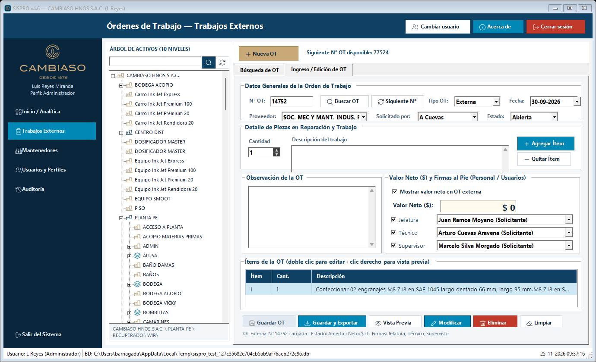
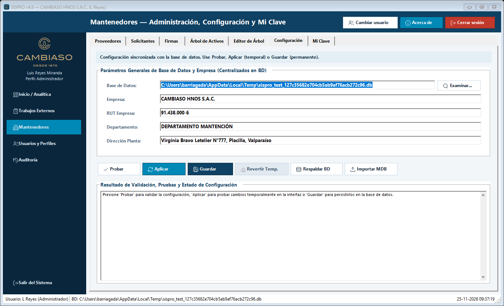
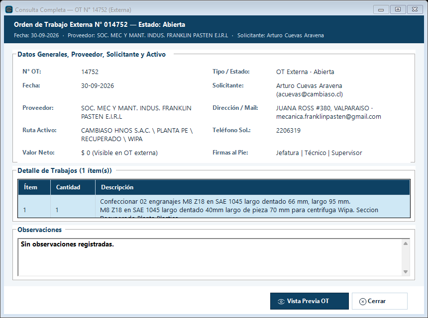
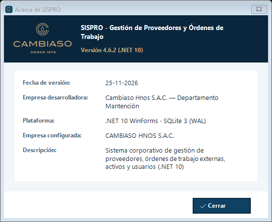
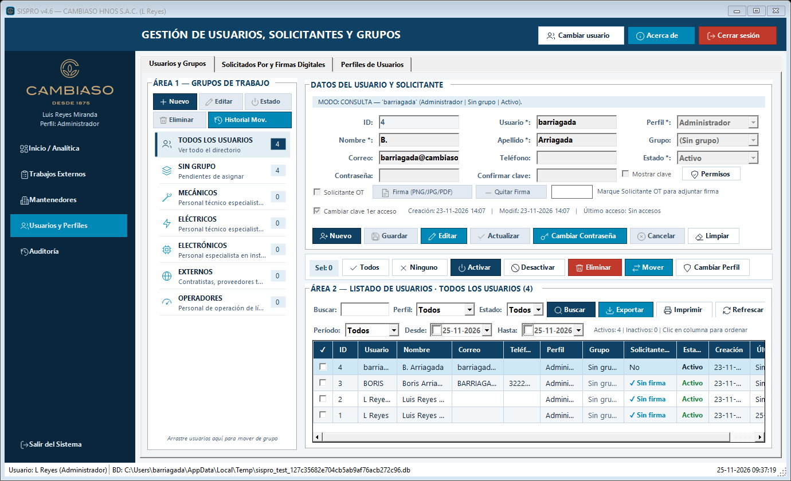
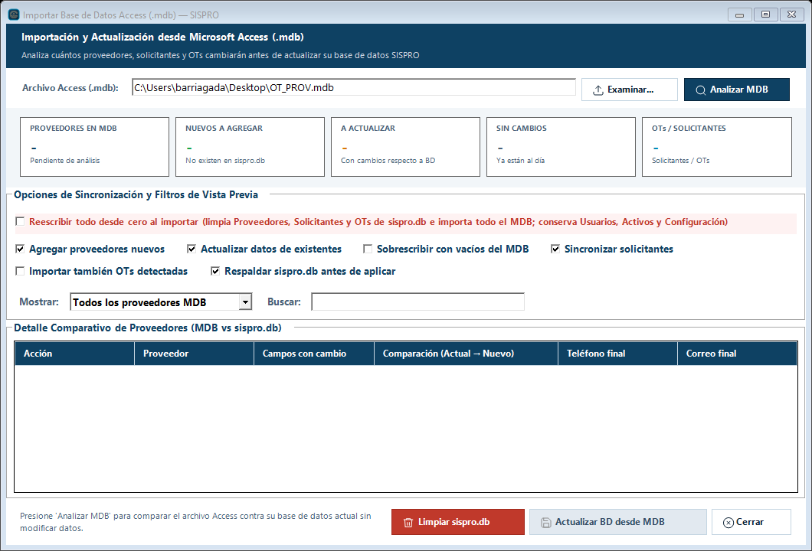

# SISPRO v4.6.2 — Sistema de Gestión de Proveedores, Órdenes de Trabajo y Solicitantes

> **Cambiaso Hnos S.A.C. — Departamento Mantención (Placilla, Valparaíso)**  
> Aplicación de escritorio corporativa en **.NET 10 (`C#` WinForms · `net10.0-windows10.0.19041.0`)** sobre **SQLite 3 (WAL)**, con **Búsqueda de OT (CRUD completo Externa/Interna)**, **gestión de 6 estados de OT (`Abierta`, `En Curso`, `Modificada`, `Terminada`, `Cerrada`, `Anulada`) al ingresar, editar y por clic derecho**, control de visibilidad **Mostrar valor neto en OT externa**, navegación administrativa centralizada en **Mantenedores** (`Editor de Árbol`, **Configuración con `Probar / Aplicar / Guardar`** en BD y **Mi Clave**), barra superior simplificada (**Cambiar usuario**, **Acerca de**, **Cerrar sesión**), **Importación Access (`.mdb`) incremental, reescritura completa desde cero y limpieza segura de `sispro.db`**, **Firmas al Pie** desde Personal/Usuarios, **Perfiles de Usuarios dinámicos** e instalador **Inno Setup 7**.

---

## Características Principales

- **Panel de Control y Barra Superior Simplificada:** Barra superior derecha con únicamente **Cambiar usuario** (cambio de cuenta en caliente sin cerrar la aplicación), **Acerca de** (metadatos centralizados de versión y fecha) y **Cerrar sesión**. Dashboard con 5 KPIs clicables, 3 gráficos vectoriales High-DPI y tabla de OTs recientes con columna **Estado** y **clic derecho → Cambiar estado / Visualizar OT**.
- **Trabajos Externos (`M1`) — Búsqueda CRUD Completa, Estados e Ingreso / Edición:** Pestaña principal **Búsqueda de OT** con barra CRUD completa (**Nuevo**, **Consultar**, **Editar**, **Eliminar**), filtro por **Estado**, menú de **clic derecho → Cambiar estado** (individual o masivo para `Abierta`, `En Curso`, `Modificada`, `Terminada`, `Cerrada` y `Anulada`), selección múltiple y exportación exclusiva de OTs seleccionadas (`.xlsx`, `.csv`, `.pdf`). En **Ingreso / Edición de OT**, selector de **Estado**, soporte para OTs **Externa** e **Interna**, checkbox **Mostrar valor neto en OT externa** (oculta el campo y omite `VALOR NETO` en plantillas PDF/Word/Excel/CSV/Vista Previa **sin borrar datos económicos** en SQLite), **Guardar y Exportar**, **Vista Previa** directa y selector de firmantes (`Jefatura`, `Técnico`, `Supervisor`).
- **Mantenedores Centralizados (`M2`) y Administración:** 7 pestañas gobernadas por RBAC: **Proveedores** (incluye **Importar MDB**), **Solicitantes**, **Firmas**, **Árbol de Activos**, **Editor de Árbol** (exclusivo Administrador), **Configuración** (exclusivo Administrador, con **Probar**, **Aplicar** temporal y **Guardar** centralizado en SQLite `ConfiguracionSistema`) y **Mi Clave** (disponible para todos los usuarios autenticados).
- **Importación, Reescritura Completa y Limpieza desde Microsoft Access (`.mdb`) (Exclusivo Administrador):** Accesible desde **Mantenedores → Proveedores → `Importar MDB`** y **Mantenedores → Configuración → `Importar MDB`**. Permite analizar el `.mdb` antes de aplicar cambios, importar de forma incremental, **Reescribir todo desde cero** en una sola transacción atómica o **Limpiar `sispro.db`** (conservando Usuarios, Perfiles, Grupos, Activos, Configuración y Auditoría) con respaldo automático previo (`backups/`).
- **Perfiles, Usuarios y Grupos (Exclusivo Administrador):** Pestaña **Perfiles de Usuarios** para crear/editar perfiles personalizados; **Usuarios y Grupos** con Drag & Drop y acciones por lotes; **Solicitados Por y Firmas Digitales** (`PNG`, `JPG`, `PDF` rasterizado vía `Windows.Data.Pdf`).
- **Seguridad, Auditoría y Sincronización:** `PBKDF2-HMAC-SHA256` (100.000 iteraciones), bloqueo ante fuerza bruta, RBAC estricto en UI y capa de servicios, consultas 100 % parametrizadas, sincronización en vivo (`SisproSyncHub` + `PRAGMA data_version`) y bitácora filtrable por módulo.

---

## Tecnologías y Arquitectura

| Capa | Proyecto | Tecnología | Responsabilidad |
|---|---|---|---|
| Dominio | `src/Sispro.Core` | `.NET 10` (`net10.0`) | Entidades, `AppMetadata`, DTOs (`MdbImportDtos`, `SignaturePersonOption`, `CoreDtos`), Enums, interfaces, PBKDF2, presets RBAC y validadores. |
| Persistencia | `src/Sispro.Data` | `Microsoft.Data.Sqlite 10.0.15` + `SQLitePCLRaw.lib.e_sqlite3 2.1.14` | Esquema WAL idempotente (`ConfiguracionSistema`, `OrdenesTrabajo.mostrar_valor_neto`, `tipo_ot`), respaldos en caliente y 9 repositorios parametrizados. |
| Negocio y Reportes | `src/Sispro.Services` | `ClosedXML 0.105.1` + `DocumentFormat.OpenXml 3.1.1` + `Windows.Data.Pdf` | Servicios RBAC transaccionales, `SystemConfigService`, `MdbImportService` (`SysWOW64`), `SisproSyncHub`, exportadores `.xlsx`/`.pdf`/`.docx`/`.csv` e impresión. |
| Interfaz | `src/Sispro.UI` | WinForms `net10.0-windows10.0.19041.0` (`PerMonitorV2`) | Identidad Cambiaso (`#0A263C`, `#0E4163`, `#0089B6`, `#C8A977`), fuentes GDI+ cacheadas, 57 íconos Lucide, `SystemSettingsControl`, `MyPasswordControl`, `AboutDialog`, `WorkOrderDetailDialog` y vistas modulares. |
| Pruebas | `tests/Sispro.Tests` | `xUnit` | **83 pruebas automatizadas** (Unit, Integration, Sync/Concurrency, Functional incl. Limpieza/Reescritura MDB, Estados OT, Navegación, Configuración, Valor Neto, CRUD OT, Perfiles y Firmantes, UI STA, Regression y Stress). |

---

## Requisitos e Instalación

- **Sistema Operativo:** Windows 10 (19041+) / Windows 11 de 64 bits (`win-x64`).
- **Instalador oficial autocontenido (no requiere instalar .NET previamente):**
  1. Descargar `SISPRO_Setup_v4.6.2_win-x64.exe` desde [Releases](https://github.com/barriagada666-collab/SISPRO-Proveedores/releases).
  2. Verificar integridad con `checksums_sha256.txt` (`SHA-256` v4.6.2: `D36400B36B971CC5599E5D8BCEB97E7A1309EB40BFBC554F1FA2EA0BC00B63DF`).
  3. Ejecutar el asistente (**ruta predeterminada:** `C:\Temp`, modificable). Las actualizaciones y desinstalaciones preservan íntegramente `sispro.db`.

---

## Configuración y Uso Rápido

- **Base de datos activa y configuración centralizada:** `%LOCALAPPDATA%\Cambiaso\SISPRO\sispro.db` (o ruta compartida de red administrable desde **Mantenedores → Configuración** con **Probar**, **Aplicar** temporal y **Guardar** en BD).
- **Primer acceso Administrador:** cuenta `barriagada` aprovisionada con `PBKDF2-HMAC-SHA256` y cambio obligatorio de contraseña en el primer ingreso. *Ninguna contraseña se almacena en este repositorio.*
- **Actualizar desde Access (`.mdb`):** como Administrador, abrir **Mantenedores → Proveedores → `Importar MDB`** (o **Mantenedores → Configuración → `Importar MDB`**) → **Examinar...** → **Analizar MDB** → revisar el resumen y presionar **Actualizar BD desde MDB**.

---

## Capturas de Pantalla

| Inicio / Splash | Panel de Control |
|---|---|
|  |  |

| Trabajos Externos (Ingreso OT) | Búsqueda y Exportación Masiva |
|---|---|
|  |  |

| Mantenedores (7 Pestañas) | Configuración (`Probar / Aplicar / Guardar`) |
|---|---|
|  |  |

| Consulta Completa de OT | Acerca de SISPRO |
|---|---|
|  |  |

| Usuarios y Grupos (RBAC) | Perfiles de Usuarios |
|---|---|
|  |  |

| Importar Access (`.mdb`) | Auditoría por Módulo y Fechas |
|---|---|
|  |  |

---

## Compilación y Despliegue

```powershell
# Compilar Debug y Release (0 errores, 0 advertencias)
dotnet build SISPRO.sln -c Debug
dotnet build SISPRO.sln -c Release

# Ejecutar las 83 pruebas automatizadas
dotnet test SISPRO.sln -c Release --no-build

# Compilar publicación autocontenida win-x64 + instalador Inno Setup 7 (v4.6.2) + SHA-256
.\scripts\Build-Release.ps1
```

---

## Documentación, Evidencias e Historial

- [Informe de Entrega `v4.6.2`](docs/INFORME_ENTREGA_v4.6.2.md) · [Informe de Incidencias y Evidencias `v4.6.2`](docs/evidencias/v4.6.2/INFORME_INCIDENCIAS_Y_VALIDACION_v4.6.2.md)
- [Informe de Entrega `v4.6.1`](docs/INFORME_ENTREGA_v4.6.1.md)
- [Informe de Entrega `v4.6.0`](docs/INFORME_ENTREGA_v4.6.0.md)
- [Informe de Entrega `v4.5.0`](docs/INFORME_ENTREGA_v4.5.0.md)
- [Informe de Entrega `v4.4.0`](docs/INFORME_ENTREGA_v4.4.0.md)
- [Informe de Entrega `v4.3.0`](docs/INFORME_ENTREGA_v4.3.0.md)
- [Informe de Entrega `v4.2.1`](docs/INFORME_ENTREGA_v4.2.1.md) · [`v4.2.0`](docs/INFORME_ENTREGA_v4.2.0.md) · [`v4.1.0`](docs/INFORME_ENTREGA_v4.1.0.md) · [Base `v4.0.0`](docs/INFORME_FINAL_ENTREGA.md)
- [Historial de Cambios (`CHANGELOG.md`)](CHANGELOG.md)
- [Arquitectura Técnica](docs/ARQUITECTURA_TECNICA.md) · [Manual Funcional](docs/MANUAL_FUNCIONAL.md) · [Reporte de Pruebas](docs/REPORTE_PRUEBAS.md) · [Guía de Compilación](docs/GUIA_COMPILACION.md) · [Guía de Despliegue](docs/GUIA_DESPLIEGUE.md)

---

## Créditos

Desarrollado para **Cambiaso Hnos S.A.C. — Departamento Mantención**, Placilla, Valparaíso, Chile.  
Licencia: [MIT](LICENSE).
