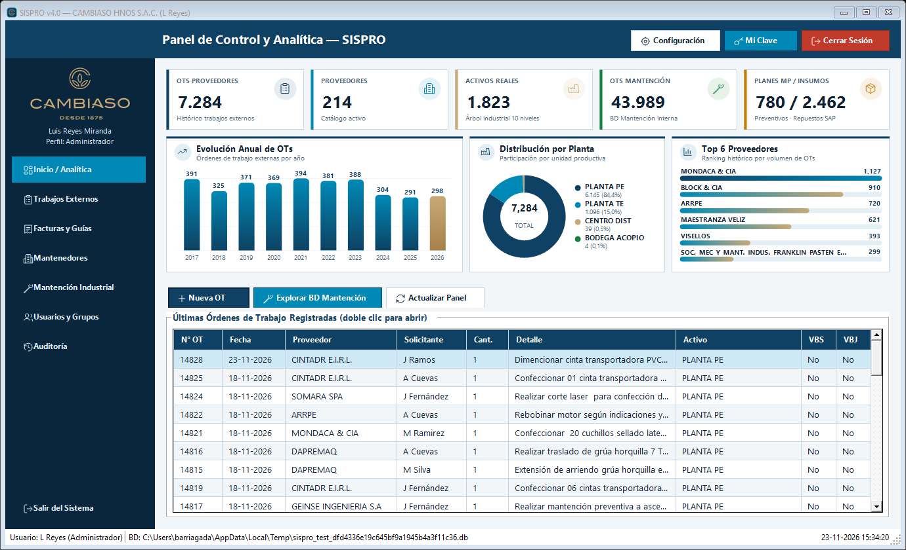
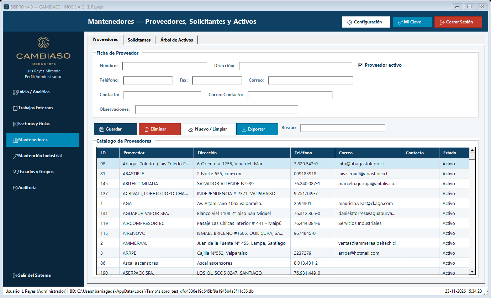

# SISPRO v4.0 — Sistema de Gestión de Proveedores, Órdenes de Trabajo y Mantención Industrial

> **Cambiaso Hnos S.A.C. — División Mantención Industrial (Placilla, Valparaíso)**  
> Aplicación de escritorio corporativa desarrollada en **.NET 10 (C# WinForms)** con base de datos **SQLite 3 (WAL)**, migración integral verificada de `OT_PROV.mdb`, `BD MANTENCION.mdb` y `PERSONAL_MANTENCION.mdb`, gestión dinámica de usuarios y grupos de trabajo en 3 áreas con operaciones por lotes y Drag & Drop, sincronización reactiva e inter-sesión, Date Pickers estandarizados (`dd-MM-yyyy`), exportaciones corporativas multiformato (**Excel, PDF, Word, CSV**) e instalador profesional **Inno Setup 6**.

---

## Características Principales

- **Panel de Control y Analítica Vectorial en Vivo:** 5 tarjetas KPI corporativas y 3 gráficos vectoriales High-DPI (Evolución anual de OTs, Distribución por Planta, Top 6 Proveedores) + últimas OTs ordenadas cronológicamente de más reciente a más antigua.
- **Órdenes de Trabajo Externas (M1):** Árbol industrial real de 10 niveles (1.824 activos), correlativo automático, ingreso/edición, aprobaciones de Supervisor (`VBS`) y Jefatura (`VBJ`), búsqueda combinada con Date Pickers (`dd-MM-yyyy`), generación e impresión oficial con firmas digitales (`JR.jpg` / `MS.jpg`) y exportación en **Excel, PDF, Word y CSV**.
- **Facturas y Guías de Despacho (M2):** Asociación transaccional por ítem de OT (bloquea doble facturación), cálculo automático de IVA 19% chileno, búsqueda combinada con rango de fechas y exportación multiformato.
- **Mantenedores (M3):** Administración integral de Proveedores, Solicitantes y Ficha Técnica editable de Activos (SAP, fabricante, modelo, serie, tipo, estado operativo, categoría y observaciones).
- **Mantención Industrial:** Exploración completa de las 43.989 OTs internas, 780 planes preventivos MP (7.704 ciclos / 208.121 tareas), 2.462 insumos SAP, 134 técnicos + 43 fichas RRHH y catálogos históricos, con Date Pickers y exportación multiformato.
- **Gestión Dinámica de Usuarios y Grupos en 3 Áreas (M4 — Exclusivo Administrador):**
  - **Área 1 (Grupos de Trabajo):** 5 categorías iniciales (`MECÁNICOS`, `ELÉCTRICOS`, `ELECTRÓNICOS`, `EXTERNOS`, `OPERADORES`) + creación de categorías personalizadas, íconos Lucide por especialidad, contadores vivos, asignación de responsable, protección ante eliminación con dependencias, historial de movimientos y zona destino **Drag & Drop**.
  - **Área 2 (Listado con CheckBoxes y Drag & Drop):** Selección individual/múltiple, búsqueda combinada por texto/perfil/grupo/estado/rango de fechas (`dd-MM-yyyy`), orden cronológico descendente (`ORDER BY fecha_creacion DESC, codigo_id DESC`) y arrastre directo de uno o varios usuarios hacia cualquier grupo.
  - **Área 3 (Acciones Individuales y por Lotes):** Activar, Desactivar, Eliminación lógica, Mover de grupo, Cambiar perfil, Restablecer clave, Exportar (Excel/PDF/Word/CSV), Imprimir y Refrescar — con diálogo de confirmación previa que muestra afectados y cuentas protegidas (sesión activa y último Administrador).
- **Sincronización Inmediata y Concurrencia:** Bus reactivo post-commit (`SisproSyncHub`), detección automática de escrituras desde otras sesiones mediante `PRAGMA data_version` cada 2,5 s, y control de concurrencia optimista (`row_version`) en usuarios y grupos.
- **Seguridad Empresarial:** Autenticación PBKDF2-HMAC-SHA256 (100.000 iteraciones), cambio obligatorio de contraseña en primer inicio de sesión, bloqueo por intentos fallidos, RBAC estricto validado en capa de servicios y BD, consultas SQL 100% parametrizadas y bitácora de auditoría filtrable y exportable.

---

## Tecnologías y Arquitectura

| Capa | Proyecto | Tecnología | Responsabilidad |
|---|---|---|---|
| Dominio | `src/Sispro.Core` | `.NET 10` | Entidades, DTOs, Enums, PBKDF2, presets RBAC, validadores (RUT, IVA, fechas). |
| Persistencia | `src/Sispro.Data` | `Microsoft.Data.Sqlite 10.0.15` + `SQLitePCLRaw 2.1.14` | Esquema idempotente WAL, índices DESC, aprovisionamiento seguro y 9 repositorios parametrizados. |
| Negocio y Reportes | `src/Sispro.Services` | `ClosedXML 0.105.1` + `DocumentFormat.OpenXml 3.1.1` + PDF 1.4 nativo | Servicios transaccionales RBAC, `SisproSyncHub`, exportadores Excel/PDF/Word/CSV e impresión. |
| Interfaz | `src/Sispro.UI` | WinForms `net10.0-windows` (`PerMonitorV2`) | Identidad Cambiaso (`#0A263C`, `#0E4163`, `#0089B6`, `#C8A977`), 48 íconos Lucide vectoriales y vistas modulares. |
| Pruebas | `tests/Sispro.Tests` | `xUnit` | 44 pruebas (Unit, Integration, Functional, UI STA, Regression, Security, Stress). |

---

## Requisitos e Instalación

- **Sistema Operativo:** Windows 10 / Windows 11 (64 bits, `win-x64`).
- **Instalador oficial (autocontenido — no requiere instalar .NET previamente):**
  1. Descargar `SISPRO_Setup_v4.0.0_win-x64.exe` desde la sección [Releases](https://github.com/barriagada666-collab/SISPRO-Proveedores/releases).
  2. Ejecutar el asistente de instalación. **Ruta predeterminada:** `C:\Temp` (modificable por el usuario durante la instalación).
  3. El instalador configura accesos directos, ícono corporativo multi-resolución y copia la base de datos inicial solo si no existe (las actualizaciones y desinstalaciones preservan los datos).

---

## Configuración y Primer Acceso

- Al iniciar, SISPRO resuelve automáticamente la base SQLite en `%LOCALAPPDATA%\Cambiaso\SISPRO\sispro.db` (copiándola desde `Data\sispro.db` en el primer arranque para operar sin privilegios de administrador).
- Desde el botón **Configuración** (exclusivo Administrador) se puede cambiar la ruta de la base de datos, generar respaldos en caliente (`BackupTo`) y ajustar los datos de la empresa.
- **Cuenta Administrador inicial:** `barriagada` (aprovisionada de forma segura con PBKDF2-HMAC-SHA256; exige cambio obligatorio de contraseña en el primer inicio de sesión). *Las credenciales iniciales nunca se almacenan en código fuente ni en este repositorio.*

---

## Gestión de Usuarios, Grupos y Permisos (RBAC)

- **Acceso exclusivo `Administrador`:** Crear, editar, activar, desactivar, eliminar lógicamente, cambiar perfiles, asignar permisos, administrar grupos, mover usuarios, ejecutar operaciones masivas y revisar auditorías.
- **Perfiles disponibles:** `Administrador` (acceso total 13/13), `Jefatura` (OT + VBJ + Facturas + Mantenedores), `Supervisor` (OT + VBS + Facturas), `Usuario` (consulta/ingreso según asignación).
- **Grupos base:** `MECÁNICOS`, `ELÉCTRICOS`, `ELECTRÓNICOS`, `EXTERNOS`, `OPERADORES` (extensibles y administrables con responsable, estado y protección contra borrado si existen integrantes o historial de movimientos).

---

## Migración de `OT_PROV.mdb` y Bases Complementarias

El 100% de los registros de origen se encuentra reconciliado y validado en [docs/REPORTE_MIGRACION_OT_PROV.md](docs/REPORTE_MIGRACION_OT_PROV.md):

| Origen | Tablas | Registros en SQLite | Integridad |
|---|---:|---:|---|
| `OT_PROV.mdb` | 10 activas | 15.320 (+3 provisión/rescate; 1 corrupto `id_ot=0` documentado) | 100% contabilizado |
| `BD MANTENCION.mdb` | 21 | 328.081 (1.824 activos, 43.989 OTs, 208.121 tareas MP, 2.462 insumos) | 0 errores FK |
| `PERSONAL_MANTENCION.mdb` | 1 | 43 fichas RRHH | 100% |
| **Total SQLite WAL** | **35 tablas** *(incl. `Grupos` y `MovimientosGrupo`)* | **343.456 registros** | `PRAGMA integrity_check = ok` |

---

## Fechas, Búsquedas y Exportaciones

- Todos los campos temporales utilizan **Date Pickers** en formato **`dd-MM-yyyy`** con atajos rápidos (`Todos`, `Hoy`, `Últ. Semana`, `Últ. Mes`, `Este Año`, `Rango`), validación `Desde <= Hasta` y día final inclusivo (`23:59:59`).
- Todos los listados históricos se ordenan en **orden cronológico descendente desde SQLite** (`ORDER BY fecha DESC, id DESC`).
- Todos los módulos principales exportan el resultado filtrado y ordenado en **4 formatos corporativos**:
  - **Excel (`.xlsx`):** Logo, encabezado Petrol/Dorado, AutoFilter, formatos chilenos y fórmulas `=SUM(...)`.
  - **PDF (`.pdf`):** Documento vectorial PDF 1.4 multipágina con logo, totales y numeración `Página X de Y`.
  - **Word (`.docx`):** Documento OpenXML estilizado con logo, tablas corporativas y pie numerado.
  - **CSV (`.csv`):** Texto UTF-8 con BOM delimitado por `;` (sin elementos gráficos).

---

## Capturas de Pantalla

| Pantalla de Arranque (`v4.0 LTS`) | Inicio de Sesión |
|---|---|
|  |  |

| Panel de Control y Analítica | Gestión de Usuarios y Grupos (3 Áreas) |
|---|---|
|  |  |

| Órdenes de Trabajo (M1) | Facturas y Guías (M2) |
|---|---|
|  |  |

| Mantenedores y Ficha Técnica (M3) | Mantención Industrial (BD Mantención) |
|---|---|
|  |  |

| Bitácora de Auditoría con Date Pickers |
|---|
|  |

---

## Compilación y Despliegue

```powershell
# Compilar Debug y Release (0 errores, 0 advertencias)
dotnet build SISPRO.sln -c Debug
dotnet build SISPRO.sln -c Release

# Ejecutar las 44 pruebas automatizadas
dotnet test SISPRO.sln -c Release --no-build

# Compilar publicación autocontenida win-x64 + instalador Inno Setup v4.0.0 + SHA-256
.\scripts\Build-Release.ps1
```

---

## Documentación, Versionado e Historial

- [Informe Final de Entrega (Secciones A–S)](docs/INFORME_FINAL_ENTREGA.md)
- [Reporte de Migración `OT_PROV.mdb`](docs/REPORTE_MIGRACION_OT_PROV.md)
- [Historial de Cambios (`CHANGELOG.md`)](CHANGELOG.md)
- [Arquitectura Técnica](docs/ARQUITECTURA_TECNICA.md) · [Manual Funcional](docs/MANUAL_FUNCIONAL.md) · [Reporte de Pruebas](docs/REPORTE_PRUEBAS.md) · [Guía de Compilación](docs/GUIA_COMPILACION.md) · [Guía de Despliegue](docs/GUIA_DESPLIEGUE.md)

---

## Créditos

Desarrollado para **Cambiaso Hnos S.A.C. — División Mantención Industrial**, Placilla, Valparaíso, Chile.  
Licencia: [MIT](LICENSE).
