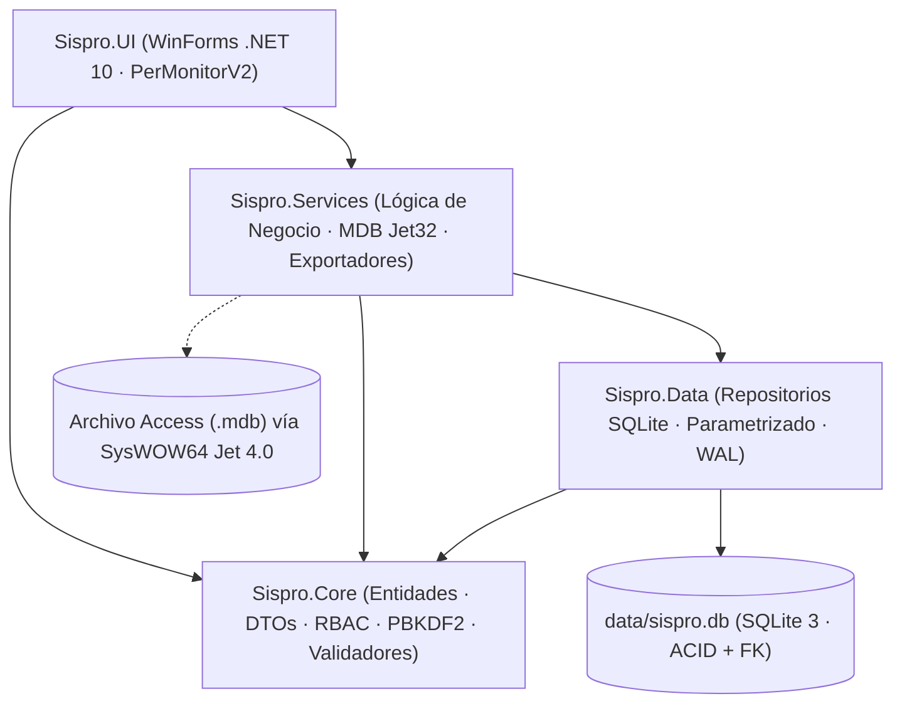
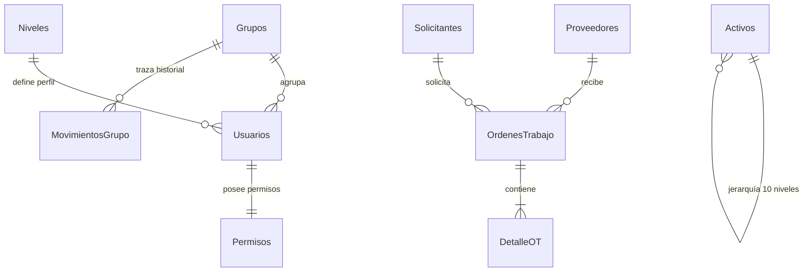

# Arquitectura Técnica — SISPRO v4.5.0 (.NET 10)

## 1. Visión General

**SISPRO** (Sistema Corporativo de Gestión de Proveedores, Órdenes de Trabajo Externas, Solicitantes y Control de Activos — Cambiaso Hnos S.A.C.) está construido en **C# sobre .NET 10 (`net10.0` / `net10.0-windows10.0.19041.0`)** bajo una arquitectura limpia en capas con separación estricta de responsabilidades, tipado estricto (`Nullable=enable`, `TreatWarningsAsErrors=true`, `AnalysisLevel=latest-recommended`) y cero vulnerabilidades NuGet. Opera sobre **SQLite 3** en modo WAL (`data/sispro.db`), preservando el histórico operativo de trabajos externos (`7.284` OTs externas, `7.803` ítems de detalle, `214` proveedores, `1.824` nodos de activos, `11` solicitantes históricos y `134` registros de `Mant_Personal`).

En `v4.5.0` se incorpora un subsistema desacoplado de **análisis comparativo e importación desde Microsoft Access (`.mdb`/`.accdb`)** (`IMdbTableReader`, `Jet32MdbTableReader`, `MdbImportService`, `MdbImportDialog`), optimización de caché de recursos GDI+ (`Font` estáticos en `CambiasoTheme` y disposición explícita de `ToolTip`), versiones dinámicas por ensamblado en UI/Impresión y cobertura ampliada de auditoría (`Perfiles`, `Importación MDB`).

---

## 2. Estructura de Proyectos (`SISPRO.sln`)

| Proyecto | Target | Responsabilidad Principal |
|---|---|---|
| `src/Sispro.Core` | `net10.0` | Entidades de dominio (`UserProfile`, `AssetNode`, `AssetNodeTypes`, `UserGroup`, `Requester`, `WorkOrder`), enumeraciones (`SignatureOption` `[Flags]`, `UserRoleLevel`, `DataChangeKind`), DTOs (`MdbImportDtos`, `SignaturePersonOption`, `CoreDtos`, `ExportDtos`), interfaces (`IMdbTableReader`, `IUserProfileRepository`, `IWorkOrderRepository`, etc.), seguridad (`PasswordSecurity`, `PermissionPresets`) y validadores (`RutValidator`, `DomainValidator`). |
| `src/Sispro.Data` | `net10.0` | Fábrica de conexiones SQLite (`SqliteConnectionFactory` con `BackupTo`), inicializador de esquema y migraciones idempotentes (`SchemaInitializer`), aprovisionador inicial (`InitialAdminProvisioner`) y 8 repositorios parametrizados (`UserProfileRepository`, `AssetTreeRepository`, `UserRepository`, `GroupRepository`, `WorkOrderRepository`, `AuditRepository`, `ProviderRepository`, `RequesterRepository`, `RepositoryHelpers`). |
| `src/Sispro.Services` | `net10.0-windows10.0.19041.0` | Servicios transaccionales con RBAC (`AuthService`, `MdbImportService`, `Jet32MdbTableReader`, `UserProfileService`, `WorkOrderService`, `MaintainerService`, `AssetTreeService`, `UserManagementService`, `GroupManagementService`), `SignatureFileService` (`Windows.Data.Pdf`), `WorkOrderSignatureLayout`, `SisproSyncHub`, `ExportSanitizer`, exportadores multiformato (`ClosedXML`, PDF vectorial, `DocumentFormat.OpenXml`, CSV) e impresión (`PrintService`). |
| `src/Sispro.UI` | `net10.0-windows10.0.19041.0` | Interfaz WinForms corporativa (`CambiasoTheme` con fuentes estáticas cacheadas sin fugas GDI+, 56 íconos vectoriales Lucide aislados por hilo STA en `IconCatalog`, `MdbImportDialog`, `AuditLogDialog`, `SettingsDialog`, `ContextMenuHelper`, `GridCheckboxSelectionController<T>`, `SortableBindingList<T>`, `GridPagerBar`, `ExportUiHelper`, `UserProfileManagerControl`, `SignatureManagerControl`, `RequesterManagerControl`, `MaintainerDependenciesDialog`, `AssetTreePanel`, `AssetTreeEditorView`, `UsersForm`, `WorkOrdersForm`, `MaintainersForm`, `MainForm`, `SplashForm`). |
| `tests/Sispro.Tests` | `net10.0-windows10.0.19041.0` | Suite `xUnit` completa (**74 pruebas**): Unit, Integration, Sync/Concurrency, Functional (incl. `MdbImportTests` con mock y verificación real de `OT_PROV.mdb`, `ProfilesSignersAndUiFeaturesTests`, `BulkOperationsAndExtendedWorkOrderTests`, `RequestersSignaturesAndApproversTests`, `AssetTreeAdministrationTests`, `UserManagementModuleTests`, `GroupsAndBatchOperationsTests`, `MultiFormatExportTests`), UI STA (`WinFormsUiAuditTests`, `ContextMenuHelperTests`, `GridSortingAndPaginationTests`, `ScreenshotCaptureTests`), Regression y Stress. |

---

## 3. Subsistema de Importación Access (`.mdb`) en Aplicaciones x64

Dado que `SISPRO.exe` compila en arquitectura nativa `win-x64` y el motor `Microsoft.Jet.OLEDB.4.0` es exclusivamente de 32 bits en Windows:

1. `Jet32MdbTableReader` implementa `IMdbTableReader` invocando `C:\Windows\SysWOW64\WindowsPowerShell\v1.0\powershell.exe` con `-NoProfile -NonInteractive -EncodedCommand` y variables de entorno (`SISPRO_MDB_PATH`, `SISPRO_OUT_DIR`) — eliminando cualquier riesgo de inyección de comandos o rutas con espacios/caracteres especiales.
2. Extrae de forma limpia las tablas existentes (`Proveedores` obligatoria; `Solicitante`, `OT_PROV`, `Detalle_ot` opcionales) a CSV UTF-8 temporales en un directorio único que se elimina en bloque `finally`.
3. `MdbImportService.AnalyzeMdb` compara el snapshot contra `sispro.db` **sin modificar la base**, deduplicando proveedores repetidos en origen, calculando diferencias campo a campo (`Dirección`, `Teléfono`, `Fax`, `Correo`) y reportando conteos exactos de proveedores nuevos, por actualizar, sin cambios, solicitantes y OTs nuevas.
4. `MdbImportService.ApplyImport` valida autorización Administrador en backend, crea respaldo opcional en caliente (`backups/sispro_pre_mdb_YYYYMMDD_HHmmss.db`), ejecuta inserciones y actualizaciones en una sola transacción `SqliteTransaction` preservando campos exclusivos de SISPRO (`contacto_prov`, `mail_contacto_prov`, `observaciones`, `activo` y firmas digitales), registra auditoría (`Importación MDB / IMPORTAR_MDB`) y publica sincronización inmediata vía `SisproSyncHub`.

---

## 4. Modelo de Datos Relacional (`sispro.db`)

Motor: **SQLite 3** (`PRAGMA foreign_keys = ON`, `PRAGMA journal_mode = WAL`, `busy_timeout = 5000ms`).

### Índices Principales
- `IX_Activos_Parent(parent_id, activo, descripcion)` — expansión rápida de subniveles.
- `IX_OT_Fecha(fecha_ot)`, `IX_OT_Numero(n_ot)`, `IX_OT_Prov(id_prov)`, `IX_OT_Sol(id_sol)`, `IX_OT_Arbol(id_n2, id_n3, id_n4, id_n5)`.
- `IX_DetalleOT_IdOt(id_ot)` y `IX_AuditLog_Fecha(fecha_utc DESC)`.

---

## 5. Seguridad, RBAC y Optimización de Recursos

- **Autenticación:** `PBKDF2-HMAC-SHA256` (100.000 iteraciones, salt 16 bytes, `FixedTimeEquals`), bloqueo temporal (30 s tras 5 intentos fallidos) y cambio obligatorio en primer ingreso.
- **Autorización en doble capa:** Validación en UI y revalidación directa contra SQLite en servicios (`AuthService.EnsureAdministrator` / `EnsurePermission`) para Usuarios, Perfiles, Grupos, Editor de Árbol, Mantenedores destructivos e Importación MDB.
- **Consultas SQL parametrizadas:** 100 % de los valores de usuario se pasan como parámetros SQLite (`$p`); las únicas interpolaciones de identificadores (`AssetTreeRepository`) utilizan listas blancas constantes en tiempo de compilación.
- **Gestión de memoria y GDI+:** Fuentes compartidas cacheadas en `CambiasoTheme`, íconos vectoriales aislados por hilo STA en `IconCatalog`, `DoubleBuffered` en grillas/vistas, `Dispose` verificado de `ToolTip`/`Timer`/suscripciones `SisproSyncHub` y operaciones I/O pesadas (`MdbImportDialog`, exportación Excel) ejecutadas fuera del hilo UI con `Task.Run`.
