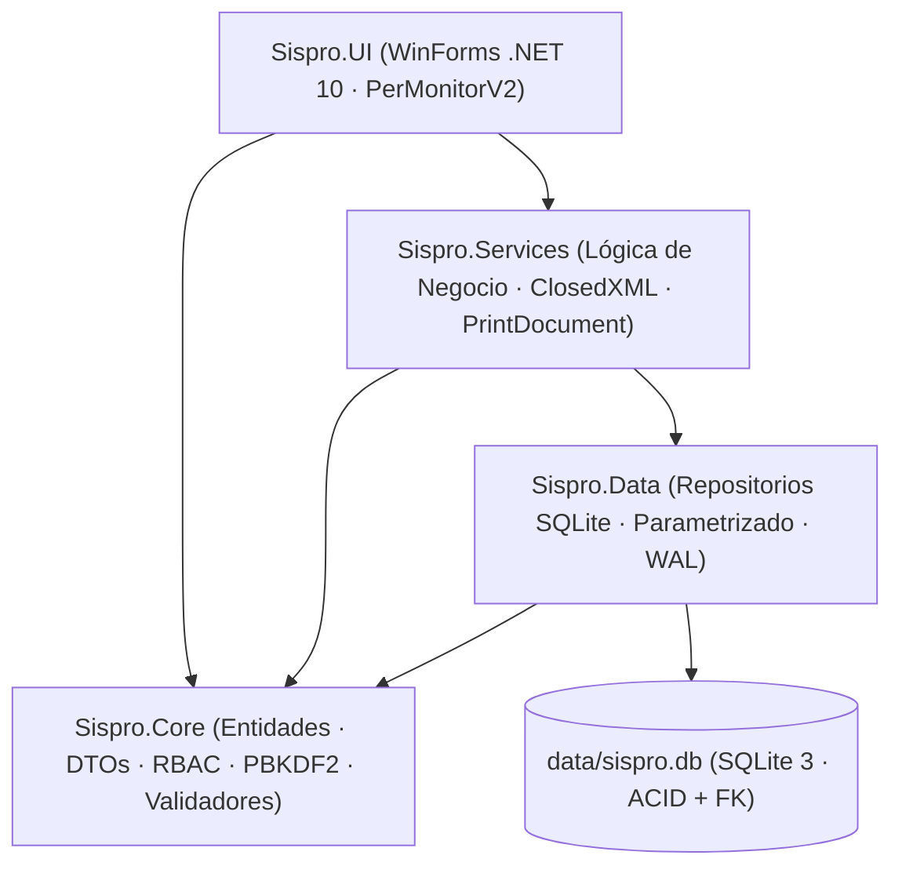
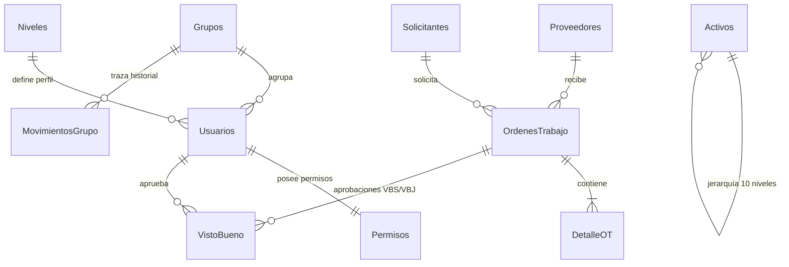

# Arquitectura Técnica — SISPRO v4.4.0 (.NET 10)

## 1. Visión General

**SISPRO** (Sistema Integral de Gestión de Proveedores, Órdenes de Trabajo Externas, Solicitantes y Control de Activos de Cambiaso Hnos S.A.C.) está construido en **C# sobre .NET 10 (`net10.0` / `net10.0-windows10.0.19041.0`)** bajo una arquitectura limpia en capas con separación estricta de responsabilidades, tipado estricto (`Nullable=enable`, `TreatWarningsAsErrors=true`) y cero dependencias COM externas. Opera sobre SQLite 3 en modo WAL (`data/sispro.db`), preservando los datos históricos operativos de trabajos externos (`7.284` OTs externas, `7.803` ítems de detalle, `214` proveedores activos, `1.824` nodos de activos, `11` solicitantes históricos / `9` activos y `134` registros de `Mant_Personal`). En `v4.4.0` se retiraron las aprobaciones `VB Supervisor`/`VB Jefatura` de toda la interfaz y reportes tabulares, se incorporó selección de firmantes desde Personal/Usuarios (`Jefatura`, `Técnico`, `Supervisor`), **Guardar y Exportar** / **Vista Previa** directa en Ingreso de OT, visualización contextual con clic derecho y administración dinámica de **Perfiles de Usuarios**.

---

## 2. Estructura de Proyectos (`SISPRO.sln`)

| Proyecto | Target | Responsabilidad Principal |
|---|---|---|
| `src/Sispro.Core` | `net10.0` | Entidades de dominio (`UserProfile`, `AssetNode`, `AssetNodeTypes`, `UserGroup`, `Requester`, `WorkOrder` con `Observacion`, `ValorNeto`, `FirmaJefaturaNombre`, `FirmaTecnicoNombre`, `FirmaSupervisorNombre` y `NombreSolicitante`), enumeraciones (`SignatureOption` `[Flags]` con `SignatureOptionExtensions`, `UserRoleLevel`), DTOs (`SignaturePersonOption`, `CoreDtos`, `MaintainerEntityKind`, `MaintainerDependencyReport`, `ExportDtos`), interfaces (`IUserProfileRepository`, `IWorkOrderRepository`), seguridad (`PasswordSecurity`, `PermissionPresets`) y validadores (`RutValidator`, `DomainValidator`). |
| `src/Sispro.Data` | `net10.0` | Fábrica de conexiones SQLite (`SqliteConnectionFactory`), inicializador de esquema y migraciones idempotentes (`SchemaInitializer`: firmas en `Solicitantes`, perfiles en `Niveles`, columnas de observación/neto/firmantes en `OrdenesTrabajo`), aprovisionador seguro (`InitialAdminProvisioner`) y 8 repositorios parametrizados (`UserProfileRepository`, `AssetTreeRepository`, `UserRepository`, `GroupRepository`, `WorkOrderRepository`, `AuditRepository`, `ProviderRepository`, `RequesterRepository`, `RepositoryHelpers`). |
| `src/Sispro.Services` | `net10.0-windows10.0.19041.0` | Servicios transaccionales con RBAC (`AuthService.EnsureAdministrator`, `UserProfileService`, `WorkOrderService`, `MaintainerService`, `AssetTreeService`, `UserManagementService`, `GroupManagementService`), gestor de firmas (`SignatureFileService` con renderizado PDF nativo vía `Windows.Data.Pdf.PdfDocument`), compositor uniforme de firmas al pie (`WorkOrderSignatureLayout`), sincronización reactiva (`SisproSyncHub`), saneamiento compartido (`ExportSanitizer`), exportadores multiformato (`DocumentExportService.BuildSelectedWorkOrdersReport`, `ExcelExportService` vía `ClosedXML`, `PdfExportService`, `WordExportService`, `CsvExportService`) e impresión (`PrintService`). |
| `src/Sispro.UI` | `net10.0-windows10.0.19041.0` | Interfaz Windows Forms con tema Cambiaso (`CambiasoTheme`, `ContextMenuHelper` seguro con ejecución diferida, `GridCheckboxSelectionController<T>`, `SortableBindingList<T>`, `GridPagerBar`, `ExportUiHelper.ShowWorkOrderPreview`), gráficas analíticas (`ModernChartPanel`), íconos Lucide vectoriales (`IconCatalog` aislado por hilo STA), `UserProfileManagerControl`, `SignatureManagerControl`, `RequesterManagerControl`, `MaintainerDependenciesDialog`, `MaintainerBatchUiHelper`, árbol 10 niveles (`AssetTreePanel`, `AssetTreeEditorView`), `UsersForm` (3 pestañas), `WorkOrdersForm`, `MaintainersForm` (4 pestañas) y diálogos seguros. |
| `tests/Sispro.Tests` | `net10.0-windows10.0.19041.0` | Suite xUnit completa (**68 pruebas**): unitarias, integración, sincronización/concurrencia, perfiles de usuarios y catálogo de firmantes (`ProfilesSignersAndUiFeaturesTests`), exportación masiva exclusiva / valor neto / firmas / dependencias e integridad referencial (`BulkOperationsAndExtendedWorkOrderTests`), administración CRUD del árbol, gestión de usuarios/grupos/lotes, solicitantes con firmas `PNG`/`JPG`/`PDF`, exportaciones multiformato, ordenamiento/paginación, auditoría UI/UX y menús contextuales en hilo STA, regresión VB6 y estrés/rendimiento. |

---

## 3. Modelo de Datos Relacional (`sispro.db`)

Motor: **SQLite 3** (`PRAGMA foreign_keys = ON`, `PRAGMA journal_mode = WAL`, `busy_timeout = 5000ms`).

### Columnas Agregadas en `OrdenesTrabajo` (Migración Idempotente `v4.3.0` → `v4.4.0`)
- `observacion` (`TEXT NOT NULL DEFAULT ''`) — notas u observaciones técnicas adicionales de la orden, visibles bajo el detalle e incluidas en documentos y exportación masiva.
- `valor_neto` (`REAL NOT NULL DEFAULT 0`) — monto neto de la orden en pesos chilenos (`CLP >= 0`), validado vía `WorkOrderService.TryParseNetValue`.
- `firmas_mask` (`INTEGER NOT NULL DEFAULT 7`) — máscara bit a bit (`SignatureOption`: `1 = Jefatura`, `2 = Supervisor`, `4 = Técnico / Solicitante`, `7 = Todas`) persistida por OT y sincronizada entre Ingreso/Edición y Generar/Imprimir.
- `firma_jefatura`, `firma_tecnico`, `firma_supervisor` (`TEXT NOT NULL DEFAULT ''`) — nombres de los firmantes seleccionados desde `Personal y Usuarios` (`Solicitantes` + `Usuarios` + `Mant_Personal`).

### Columnas Agregadas en `Niveles` — Perfiles de Usuarios (`v4.4.0`)
- `descripcion` (`TEXT`), `es_sistema` (`INTEGER`: `1` para los 4 perfiles base, `0` para personalizados), `activo` (`INTEGER`) y permisos por defecto (`m1_ot`, `tab_0_1_ingreso_ot`, `tab_0_2_busqueda_ot`, `tab_0_3_impresion_ot`, `m3_mantenedor`).

### Columnas Agregadas en `Solicitantes` (Migración Idempotente `v4.2.0`)
- `firma_bytes` (`BLOB`) — contenido binario original validado (`PNG`, `JPG` o `PDF`, máx. 10 MB).
- `firma_nombre` (`TEXT`) — nombre de archivo original adjunto.
- `firma_tipo` (`TEXT`) — tipo MIME/extensión normalizada (`png`, `jpg`, `pdf`).
- `firma_preview_png` (`BLOB`) — miniatura PNG rasterizada (pág. 1 vía `Windows.Data.Pdf` para archivos PDF) lista para vista previa e incrustación en documentos.

### Índices de Rendimiento
- `IX_Activos_Parent(parent_id, activo, descripcion)` — expansión instantánea de nodos en `AssetTreePanel`.
- `IX_OT_Fecha(fecha_ot)` — búsquedas por rango cronológico en milisegundos.
- `IX_OT_Prov(id_prov)` y `IX_OT_Sol(id_sol)` — filtros por proveedor y solicitante.
- `IX_OT_Arbol(id_n2, id_n3, id_n4, id_n5)` — filtrado por ubicación en planta.
- `IX_DetalleOT_IdOt(id_ot)` — carga inmediata de detalles por OT.
- `IX_AuditLog_Fecha(fecha_utc DESC)` — consulta ordenada de auditoría.

---

## 4. Modelo de Seguridad y Control de Acceso (RBAC)

1. **Autenticación**:
   - Hash criptográfico `PBKDF2-HMAC-SHA256` con 100.000 iteraciones y salt aleatorio de 16 bytes por usuario.
   - Comparación en tiempo constante (`CryptographicOperations.FixedTimeEquals`).
   - Compatibilidad transitoria de lectura para cuentas migradas desde `OT_PROV.mdb` (`LEGACY_VB6$...`), con actualización automática e irreversible a PBKDF2 tras el primer inicio de sesión válido.
   - Protección contra fuerza bruta: bloqueo temporal de 30 segundos tras 5 intentos fallidos consecutivos por alias.
2. **Autorización en Doble Capa**:
   - **Capa UI**: Menús, pestañas y botones sensibles (VB Supervisor, VB Jefatura, Configuración, Auditoría, Editor de Árbol, Usuarios y Solicitantes) se habilitan/ocultan estrictamente según `UserPermissions` y perfil.
   - **Capa Services**: Cada operación crítica valida `AuthService.EnsurePermission(...)` o revalida perfil Administrador en base de datos, impidiendo escalación de privilegios incluso mediante invocación directa.
3. **Resguardo Operacional**:
   - Imposibilidad de eliminar la sesión propia o degradar/desactivar al último administrador activo.
   - Registro automático en `AuditLog` de accesos, cambios de clave, CRUD de OTs, aprobaciones VBS/VBJ con usuario y fecha, solicitantes/firmas, mantenedores y respaldos.

---

## 5. Optimizaciones de Rendimiento y UI

- **Doble buffer (`DoubleBuffered = true`)** en grillas, formularios y contenedor de módulos para eliminar parpadeos.
- **Instanciación diferida y reutilización de vistas** en `MainForm` para cambio instantáneo entre módulos.
- **Árbol de activos con carga diferida (Lazy Loading)** por nodo padre + búsqueda indexada directa.
- **Exportación Excel asíncrona** en `Task.Run` con reporte de progreso (`IProgress<int>`) sin congelar el hilo de UI.
- **Soporte High-DPI `PerMonitorV2`** con layouts fluidos (`TableLayoutPanel`, `SplitContainer`, `FlowLayoutPanel`).
