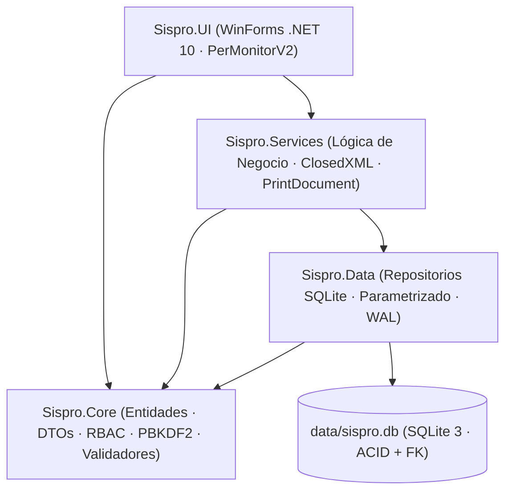
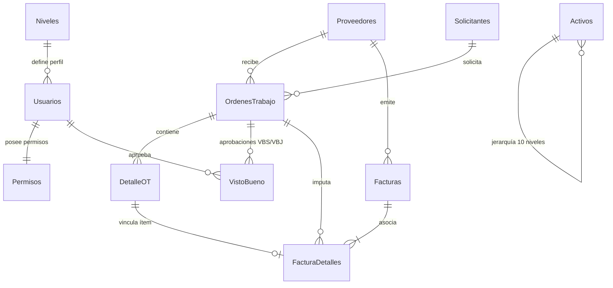

# Arquitectura Técnica — SISPRO v2.0 (.NET 10)

## 1. Visión General

**SISPRO** (Sistema de Gestión de Proveedores y Órdenes de Trabajo de Cambiaso Hnos S.A.C.) está construido en **C# sobre .NET 10 (`net10.0-windows`)** bajo una arquitectura limpia en capas con separación estricta de responsabilidades, tipado estricto (`Nullable=enable`, `TreatWarningsAsErrors=true`) y cero dependencias COM externas.

---

## 2. Estructura de Proyectos (`SISPRO.sln`)

| Proyecto | Target | Responsabilidad Principal |
|---|---|---|
| `src/Sispro.Core` | `net10.0` | Entidades de dominio, enumeraciones, DTOs, interfaces de repositorio, seguridad (`PasswordSecurity`, `PermissionPresets`) y validadores (`RutValidator`, `TaxCalculator`, `DomainValidator`). |
| `src/Sispro.Data` | `net10.0` | Fábrica de conexiones SQLite (`SqliteConnectionFactory`), inicializador de esquema (`SchemaInitializer`) y repositorios parametrizados con transacciones ACID. |
| `src/Sispro.Services` | `net10.0-windows` | Servicios de aplicación (`AuthService`, `WorkOrderService`, `InvoiceService`, `MaintainerService`, `UserManagementService`), exportación Excel (`ExcelExportService` vía `ClosedXML`) e impresión nativa (`PrintService` vía `PrintDocument`). |
| `src/Sispro.UI` | `net10.0-windows` | Interfaz de escritorio Windows Forms con tema corporativo Cambiaso, catálogo de íconos vectoriales (`IconCatalog`), control de árbol de activos de 10 niveles con carga diferida (`AssetTreePanel`), módulos principales y diálogos administrativos. |
| `tests/Sispro.Tests` | `net10.0-windows` | Suite xUnit completa: pruebas unitarias, integración (incluyendo base real migrada), funcionales E2E, auditoría UI/UX en hilo STA, regresión de defectos VB6 y estrés/rendimiento. |

---

## 3. Modelo de Datos Relacional (`sispro.db`)

Motor: **SQLite 3** (`PRAGMA foreign_keys = ON`, `PRAGMA journal_mode = WAL`, `busy_timeout = 5000ms`).

### Índices de Rendimiento
- `IX_Activos_Parent(parent_id, activo, descripcion)` — expansión instantánea de nodos en `AssetTreePanel`.
- `IX_OT_Fecha(fecha_ot)` — búsquedas por rango cronológico en milisegundos.
- `IX_OT_Prov(id_prov)` y `IX_OT_Sol(id_sol)` — filtros por proveedor y solicitante.
- `IX_OT_Arbol(id_n2, id_n3, id_n4, id_n5)` — filtrado por ubicación en planta.
- `IX_DetalleOT_IdOt(id_ot)` — carga inmediata de detalles por OT.
- `IX_Facturas_Prov(id_prov, fecha_fac)` y `IX_FacDet_Ot(id_ot)` — trazabilidad factura ↔ OT.
- `IX_AuditLog_Fecha(fecha_utc DESC)` — consulta ordenada de auditoría.

---

## 4. Modelo de Seguridad y Control de Acceso (RBAC)

1. **Autenticación**:
   - Hash criptográfico `PBKDF2-HMAC-SHA256` con 100.000 iteraciones y salt aleatorio de 16 bytes por usuario.
   - Comparación en tiempo constante (`CryptographicOperations.FixedTimeEquals`).
   - Compatibilidad transitoria de lectura para cuentas migradas desde `OT_PROV.mdb` (`LEGACY_VB6$...`), con actualización automática e irreversible a PBKDF2 tras el primer inicio de sesión válido.
   - Protección contra fuerza bruta: bloqueo temporal de 30 segundos tras 5 intentos fallidos consecutivos por alias.
2. **Autorización en Doble Capa**:
   - **Capa UI**: Menús, pestañas y botones sensibles (VB Supervisor, VB Jefatura, Configuración, Auditoría, Eliminar Facturas) se habilitan/ocultan estrictamente según `UserPermissions`.
   - **Capa Services**: Cada operación crítica valida `AuthService.EnsurePermission(...)`, impidiendo escalación de privilegios incluso mediante invocación directa.
3. **Resguardo Operacional**:
   - Imposibilidad de eliminar la sesión propia o degradar/desactivar al último administrador activo.
   - Registro automático en `AuditLog` de accesos, cambios de clave, CRUD de OTs, aprobaciones VBS/VBJ, facturas, mantenedores y respaldos.

---

## 5. Optimizaciones de Rendimiento y UI

- **Doble buffer (`DoubleBuffered = true`)** en grillas, formularios y contenedor de módulos para eliminar parpadeos.
- **Instanciación diferida y reutilización de vistas** en `MainForm` para cambio instantáneo entre módulos.
- **Árbol de activos con carga diferida (Lazy Loading)** por nodo padre + búsqueda indexada directa.
- **Exportación Excel asíncrona** en `Task.Run` con reporte de progreso (`IProgress<int>`) sin congelar el hilo de UI.
- **Soporte High-DPI `PerMonitorV2`** con layouts fluidos (`TableLayoutPanel`, `SplitContainer`, `FlowLayoutPanel`).
